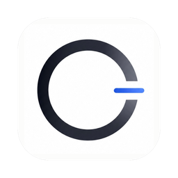
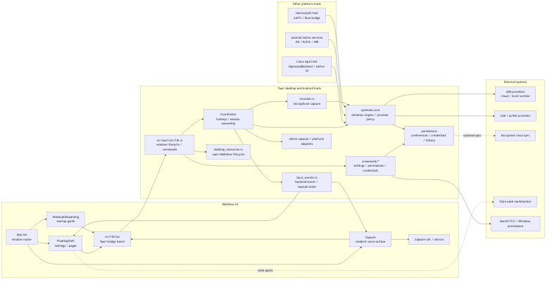
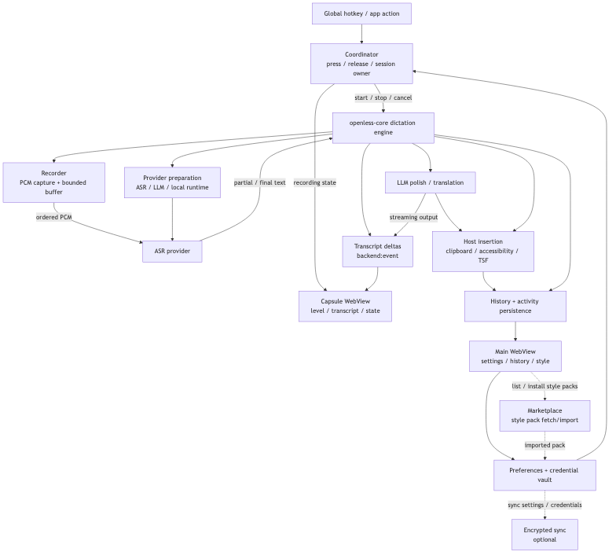
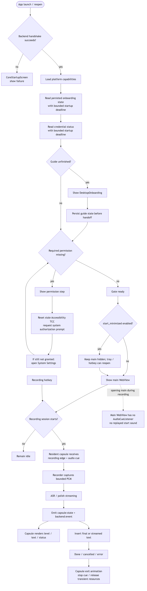

<p align="center">
  
</p>

<h1 align="center">OpenLess</h1>

<p align="center">
  <strong>Open-source voice input for macOS, Windows, Linux, Android, iOS &amp; HarmonyOS</strong>
</p>

<p align="center">
  Hold a hotkey, speak, and watch AI-polished text stream straight to your cursor —<br/>
  in the writing style <em>you</em> choose.
</p>

<p align="center">
  <a href="https://openless.top"><strong>Website</strong></a>
  &nbsp;·&nbsp;
  <a href="https://openless.top/en/docs/"><strong>Online Docs</strong></a>
  &nbsp;·&nbsp;
  <a href="https://github.com/Open-Less/openless/releases/latest"><strong>Download</strong></a>
  &nbsp;·&nbsp;
  <a href="docs/index.md"><strong>Repo Docs</strong></a>
  &nbsp;·&nbsp;
  <a href="README.md">English</a>
  &nbsp;/&nbsp;
  <a href="README.zh.md">中文</a>
</p>

<p align="center">
  <a href="https://github.com/Open-Less/openless/releases/latest"></a>
  <a href="LICENSE"></a>
  <a href="https://github.com/Open-Less/openless"></a>
</p>

<p align="center">
  
  
  
  
  
  
  
  
</p>

<p align="center">
  QQ Group 1&nbsp; <strong>1078960553</strong> (full) &nbsp;·&nbsp; QQ Group 2&nbsp; <strong>1095794054</strong>
</p>

<br/>

<h2 align="center">Sponsors</h2>

<p align="center">
  <em>OpenLess is sustained by the generous support of its sponsors.</em>
</p>

<p align="center">
  <a href="https://www.mivra.dev/" target="_blank" rel="noopener">
    
  </a>
  <br/>
  <a href="https://www.mivra.dev/" target="_blank" rel="noopener">Mivra (mivra.dev)</a>
</p>

<p align="center">
  Mivra provides cloud servers and bare-metal servers, with nodes in Hong Kong and the United States, gaming cloud services, and on-demand configurations, delivering stable, reliable computing power for small and medium-sized businesses.
</p>

<h2 align="center">Developers</h2>

<table align="center">
  <tr>
    <td align="center" width="170">
      <br/>
      <strong><a href="https://tripmc.top/" target="_blank" rel="noopener">TRIP</a></strong><br/>
      <sub>Author</sub>
    </td>
    <td align="center" width="170">
      <br/>
      <strong><a href="https://github.com/H-Chris233" target="_blank" rel="noopener">Chris233</a></strong><br/>
      <sub>Author / Maintainer</sub>
    </td>
    <td align="center" width="170">
      <br/>
      <strong>bigsong</strong><br/>
      <sub>Contributor / Tester</sub>
    </td>
  </tr>
  <tr>
    <td align="center" width="170">
      <br/>
      <strong><a href="https://github.com/HKLHaoBin" target="_blank" rel="noopener">HKLHaoBin</a></strong><br/>
      <sub>Android Author / Android Maintainer</sub>
    </td>
    <td align="center" width="170">
      <br/>
      <strong><a href="https://github.com/Cooper-X-Oak" target="_blank" rel="noopener">Cooper</a></strong><br/>
      <sub>Contributor</sub>
    </td>
    <td align="center" width="170">
      <br/>
      <strong><a href="https://github.com/aeoform" target="_blank" rel="noopener">aeoform</a></strong><br/>
      <sub>Contributor / Linux Maintainer</sub>
    </td>
  </tr>
</table>

OpenLess is a cross-platform (macOS, Windows, Linux, Android, iOS, and HarmonyOS) voice-input application — a fully open-source alternative to commercial tools such as [Typeless](https://www.typeless.com/), [Wispr Flow](https://wisprflow.ai), Lazy, and Superwhisper. Official website and documentation: **[openless.top](https://openless.top)**.

Place your cursor in any text field — ChatGPT, Claude, Cursor, Notion, an email draft, or a chat box — press a global hotkey, and speak. OpenLess records audio, transcribes it, polishes the text in the style you choose, and inserts the result straight at your cursor. If an app blocks direct insertion, the text is automatically copied to the clipboard so nothing is lost.

## Platform Support

Six hosts share one framework-independent Rust core (`openless-core`):

| Platform | Host | State | Distribution |
| --- | --- | --- | --- |
| **macOS 14 Sonoma+** | Tauri 2 + React (`src-tauri/`) | Complete desktop app: hotkey, insertion, continuous dictation, style packs, cursor context, Apple Speech, experimental local ASR | DMG (Apple Silicon / Intel), Homebrew cask |
| **Windows 10+** | Tauri 2 + React (`src-tauri/`) | Complete desktop app, native TSF input method (`windows-ime/`), Foundry/sherpa local ASR | NSIS / MSI installer |
| **Linux** | Native `egui` / `eframe` host (`linux-egui/`, no Tauri/WebKitGTK) | Core 2.0 services wired to native UI + `fcitx5` plugin; device acceptance open | Source build (see [Linux guide](docs/development/linux.md)) |
| **Android 8.0+** | Tauri mobile host + React, OpenLess keyboard (`android/`, `mobile-ime/`) | App, floating capsule, IME, cursor context, in-app updates | APKs per ABI |
| **iOS 16+** | Native SwiftUI/UIKit app, keyboard extension, widget (`openless-all/ios/`) | Chinese/English typing, voice-focused & hold-space modes, translation, local SenseVoice | Source build + personal signing (see [iOS guide](openless-all/ios/README.md)) |
| **HarmonyOS** | ArkTS + ArkWeb + napi Core (`app/harmony/`, `mobile-ime/`) | Adapting: HAP builds & IME wired to shared pipeline; real-network & store acceptance pending | Unsigned HAP in Releases (see [HarmonyOS guide](openless-all/app/harmony/README.md)) |

## Highlights

- **Three Speech & Model Pipelines**:
  - **Traditional (ASR + optional LLM)**: Nearly 30 cloud/local ASR options (Volcengine, Alibaba Cloud Bailian, iFlytek RTASR, Tencent Hunyuan, StepFun, GLM, MiMo, Whisper-compatible, Apple Speech, Foundry/sherpa/MLX local models) paired with 20+ LLM providers (Ark, DeepSeek, OpenAI, Gemini, OpenRouter, custom OpenAI-compatible endpoints).
  - **Multimodal (Single Model)**: Audio-capable models (Google Gemini, OpenAI Audio, Qwen-Omni) transcribe and polish in one step.
  - **DeepSeek Suite**: Unified DeepSeek official key for dictation, Ask, web search, and spoken readback.
- **Continuous Dictation & Streaming Insertion**: Finish speaking one segment and immediately start the next — previous segments process asynchronously in the background and write back to their original target in order. Streaming insertion writes polished text progressively with automatic clipboard fallback.
- **Style Packs, App Routing & Marketplace**: Four built-in modes (Raw, Light Polish, Structured AI Prompt, Formal), custom system-prompt Style Packs with per-app automatic routing, and a curated in-app **Marketplace**.
- **Personal Dictionary & Opt-in Cursor Context**: Hotword-prioritized dictionary, opt-in local vocabulary learning from post-insertion edits (never silent, never uploaded), and opt-in cursor context (excluding passwords, Secure Input, and terminals) to resolve homophones.
- **Mobile Remote Input & Encrypted Cloud Sync**: Dictate from your phone browser over verified LAN HTTPS straight to your computer ([Remote Input Guide](docs/guides/remote-input.md)), or sync preferences, keys, and history across devices with client-side end-to-end encryption.

## Concrete Example

Hold the hotkey and speak naturally:

> Uh... I need to reply to the proposal the client sent last time. We discussed it internally — overall direction looks fine, just a couple of things to adjust. First, the delivery timeline is too tight, we'd like to push it back two weeks. Second, budget — their quote is about 20% higher than we expected, can we negotiate? Also let them know we're genuinely keen to work together, keep the tone polite and not too stiff.

Release the hotkey, and in **Structured (AI Prompt)** mode OpenLess inserts:

```text
Draft a polite, collaborative reply to the client's previous proposal. After internal review, the overall direction looks good, with two points to adjust:

1. Delivery timeline
   (a) The current schedule is too tight; request extending delivery by two weeks.
2. Budget
   (a) Their quote is roughly 20% above our expectation; ask whether there is room to renegotiate.

Overall tone: express clear willingness to collaborate, stay polite, and avoid sounding abrupt.
```

More before/after rewrite examples live at **[openless.top/en/docs/voice-input/](https://openless.top/en/docs/voice-input/)** and in [docs/references/polish-reference-examples.sample.jsonl](docs/references/polish-reference-examples.sample.jsonl).

## Stability Freeze

OpenLess currently prioritizes voice-input stability and core dictation quality (recording, transcription, history recovery, reliable writeback, compatibility, tests, and documentation). Out-of-scope features and oversized PRs are paused — see [Maintenance Notice #1479](https://github.com/Open-Less/openless/issues/1479).

## Quick Start & Documentation

- **Download & Install**: [GitHub Releases](https://github.com/Open-Less/openless/releases/latest) · [Online Install Guide](https://openless.top/en/docs/installation/) · [User Guide (USAGE.md)](USAGE.md)
- **Speech & Model Setup**: [Online Setup Guide (openless.top)](https://openless.top/en/docs/setup/) · [Repo Entry Guide](docs/guides/speech-services.md)
- **All-Platform Developer Build Guide**: [openless-all/README.md](openless-all/README.md) (macOS, Windows, Linux, Android, HarmonyOS, iOS)
- **iOS Build & Signing Guide**: [openless-all/ios/README.md](openless-all/ios/README.md)
- **Linux Native egui Host & Interface**: [docs/development/linux.md](docs/development/linux.md)
- **Full Documentation Index**: [docs/index.md](docs/index.md)

## Architecture & Data Flow

OpenLess separates UI, platform hosts, and business logic into three layers:

```text
React UI  ── Tauri Adapter (macOS / Windows / Android) ──┐
egui UI   ── Linux Native Host (no Tauri / WebKitGTK) ───┤
SwiftUI   ── iOS Native App & Keyboard (CoreHost) ───────┼── openless-core
ArkTS UI  ── HarmonyOS Adapter (ArkWeb + napi) ──────────┘
```

Core dictation data flow (aligned with [openless.top/en/docs/development/](https://openless.top/en/docs/development/#architecture) and [docs/architecture.md](docs/architecture.md)):

`Global Hotkey / Trigger → Coordinator (Session Ownership) → Microphone PCM Capture → openless-core Dictation Engine → ASR + LLM / Multimodal / DeepSeek Suite (with App Style Pack & Dictionary) → Safe Cursor Insertion / Clipboard Fallback → Local History & Stats`

- Continuous multi-segment dictation queues completed recordings asynchronously in the background while keeping target-app and cursor context frozen per segment.
- API keys are stored exclusively in OS credential vaults (macOS Keychain, Windows Credential Manager, Linux Secret Service, iOS Keychain) — never committed to source or saved as plaintext config.
- Full module boundaries, IPC/socket contracts, and data flows are documented in **[docs/architecture.md](docs/architecture.md)**.

### Client Architecture & Flow Diagrams

Source Mermaid files (`.mmd`) and exports (`.svg`, `.png`) live in [docs/images/client-diagrams/README.md](docs/images/client-diagrams/README.md):

#### Client Architecture



[Mermaid](docs/images/client-diagrams/openless-client-architecture.mmd) · [SVG](docs/images/client-diagrams/openless-client-architecture.svg) · [中文 PNG](docs/images/client-diagrams/openless-client-architecture.zh-CN.png) · [中文 SVG](docs/images/client-diagrams/openless-client-architecture.zh-CN.svg)

#### Client Data Flow



[Mermaid](docs/images/client-diagrams/openless-client-data-flow.mmd) · [SVG](docs/images/client-diagrams/openless-client-data-flow.svg) · [中文 PNG](docs/images/client-diagrams/openless-client-data-flow.zh-CN.png) · [中文 SVG](docs/images/client-diagrams/openless-client-data-flow.zh-CN.svg)

#### Startup, Permissions & Recording Flow



[Mermaid](docs/images/client-diagrams/openless-client-startup-recording-flow.mmd) · [SVG](docs/images/client-diagrams/openless-client-startup-recording-flow.svg) · [中文 PNG](docs/images/client-diagrams/openless-client-startup-recording-flow.zh-CN.png) · [中文 SVG](docs/images/client-diagrams/openless-client-startup-recording-flow.zh-CN.svg)

## Contributing & Releases

- **Two channels**: `beta` is the default integration branch (Beta channel); `main` is the Stable channel (maintainer merges from `beta` only). Always open PRs against `beta`.
- **Updater CDN**: Desktop updater manifests are served from `https://dl.aeoform.com/updates/{stable|beta}/latest-{target}-{arch}[ -beta].json` rather than GitHub Release assets.
- **Maintainer release checklist**: [RELEASING.md](RELEASING.md) covers admin-only release authority, the 5-file version-sync gate, signing/notarization, HarmonyOS channels, and release-note attribution.

## Roadmap

- Cross-session style memory ([#46](https://github.com/Open-Less/openless/issues/46))
- Snippets UI and trigger workflow
- "Paste last result" shortcut
- HarmonyOS: real-network on-device acceptance, update checks, and store distribution
- Linux: on-device L01–L12 acceptance and resuming deb/rpm release automation

## Acknowledgements

OpenLess thanks its sponsors, developers, contributors, and the broader LinuxDo community for its open, pragmatic, developer-friendly spirit. This acknowledgement does not imply any official endorsement or affiliation.

## Third-Party Components & Font Attribution

- **Rare UI** (Copyright (c) 2026 Swami Malode, [MIT + Commons Clause + Attribution](openless-all/app/public/licenses/rare-ui-LICENSE.txt)):
  - Annual activity card adapted from [GitHub Activity](docs/ATTRIBUTION.md#rare-ui-github-activity)
  - Shared password eye animation adapted from [Password Input](docs/ATTRIBUTION.md#rare-ui-password-input)
  - Notification surface adapted from [Toast](docs/ATTRIBUTION.md#rare-ui-toast)
  - Ask Anything interaction references from [AI Prompt Box & Streaming Response](docs/ATTRIBUTION.md#rare-ui-ai-prompt-box-and-streaming-response)
- **Open Runde Fonts**: Bundled UI typography licensed under the [SIL Open Font License 1.1](openless-all/app/public/licenses/open-runde-OFL.txt).

Full third-party component and font attributions are recorded in **[docs/ATTRIBUTION.md](docs/ATTRIBUTION.md)** and inside the app under **Settings → About and updates → Component credits**.

## License

OpenLess 2.0 is licensed under **[AGPL-3.0-only](LICENSE)**. Published 1.x releases remain under their original MIT license.
