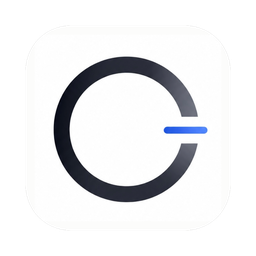

<p align="center">
  
</p>

<h1 align="center">OpenLess</h1>

<p align="center">
  <strong>全平台开源 AI 语音输入工具 — 支持 macOS、Windows、Linux、Android、iOS 与 HarmonyOS</strong>
</p>

<p align="center">
  按住快捷键直接说，把脑海里的完整思路瞬间变成干净、结构清晰、能直接丢给 AI 或发给同事的文字。<br/>
  <strong>零数据收集 · 行业第一的后处理速度 · 专为长 Prompt 深度打造</strong>
</p>

<p align="center">
  <a href="https://openless.top"><strong>官网</strong></a>
  &nbsp;·&nbsp;
  <a href="https://openless.top/zh/docs/"><strong>在线文档</strong></a>
  &nbsp;·&nbsp;
  <a href="https://github.com/Open-Less/openless/releases/latest"><strong>下载</strong></a>
  &nbsp;·&nbsp;
  <a href="docs/architecture.md"><strong>架构与平台文档</strong></a>
  &nbsp;·&nbsp;
  <a href="README.md">English</a>
  &nbsp;/&nbsp;
  <a href="README.zh.md">中文</a>
</p>

<p align="center">
  <a href="https://github.com/Open-Less/openless/releases/latest"></a>
  <a href="https://github.com/Open-Less/openless/releases"></a>
  <a href="LICENSE"></a>
  <a href="https://github.com/Open-Less/openless"></a>
</p>

<p align="center">
  
  
  
  
  
  
</p>

<p align="center">
  QQ 一群&nbsp; <strong>1078960553</strong>（已满员） &nbsp;·&nbsp; QQ 二群&nbsp; <strong>1095794054</strong>
</p>

---

## 赞助商

<p align="center">
  <em>OpenLess 的持续发展离不开赞助商的慷慨支持。</em>
</p>

<p align="center">
  <a href="https://www.mivra.dev/" target="_blank" rel="noopener">
    
  </a>
  <br/>
  <a href="https://www.mivra.dev/" target="_blank" rel="noopener">Mivra (mivra.dev)</a>
</p>

<p align="center">
  Mivra 提供云服务器与裸金属服务器，节点覆盖香港与美国，另有游戏云服务与按需配置，为中小企业提供稳定、可靠的算力。
</p>

---

## OpenLess 是一款什么样的开源替代品？

OpenLess 是一款覆盖 **macOS、Windows、Linux、Android、iOS 与 HarmonyOS** 的全平台开源 AI 语音输入工具，旨在成为 [Typeless](https://www.typeless.com/)、[Wispr Flow](https://wisprflow.ai)、Lazy、Superwhisper 等商业闭源产品的**完全开源替代方案**——应用本身彻底免费、代码完全公开、零订阅套路、不绑定任何一家厂商或平台。

### 开发者

<table align="center">
  <tr>
    <td align="center" width="170">
      <br/>
      <strong><a href="https://tripmc.top/" target="_blank" rel="noopener">TRIP</a></strong><br/>
      <sub>作者</sub>
    </td>
    <td align="center" width="170">
      <br/>
      <strong><a href="https://github.com/H-Chris233" target="_blank" rel="noopener">Chris233</a></strong><br/>
      <sub>作者 / 维护者</sub>
    </td>
    <td align="center" width="170">
      <br/>
      <strong>bigsong</strong><br/>
      <sub>贡献者 / 测试</sub>
    </td>
  </tr>
  <tr>
    <td align="center" width="170">
      <br/>
      <strong><a href="https://github.com/HKLHaoBin" target="_blank" rel="noopener">HKLHaoBin</a></strong><br/>
      <sub>Android 端作者 / Android 维护者</sub>
    </td>
    <td align="center" width="170">
      <br/>
      <strong><a href="https://github.com/Cooper-X-Oak" target="_blank" rel="noopener">Cooper</a></strong><br/>
      <sub>贡献者</sub>
    </td>
    <td align="center" width="170">
      <br/>
      <strong><a href="https://github.com/aeoform" target="_blank" rel="noopener">aeoform</a></strong><br/>
      <sub>贡献者 / Linux 维护者</sub>
    </td>
  </tr>
</table>

### 和豆包、免费千问等产品有什么区别？

很多人第一反应会问：「豆包、免费千问也能语音输入，我为什么要用 OpenLess？」——因为我们在定位和底层体验上完全不是一类东西：

1. **我们不会收集用户的任何数据**
   豆包、免费千问等大厂免费工具往往绑定平台账号与云端生态，语音和文本数据容易流经厂商服务体系；而 **OpenLess 不会收集用户的任何数据**——没有后台埋点，没有云端留存分析，也不会把你的口述内容拿去训练模型。你的听写历史、个人词典、风格包和纠正规则全部保存在本地设备；你填入的第三方 API Key 由你的设备直连对应服务商（也支持纯本地离线模型），不经过任何 OpenLess 中转服务器。
2. **后处理速度超级快，稳居行业第一**
   市面上绝大多数带 AI 润色或 Prompt 整理的语音输入工具，松开快捷键后都要干等好几秒甚至更久，极度打断思路。OpenLess 对整条语音识别与后处理链路做了深度优化，在所有做 Prompt 后处理的厂商、平台和开源项目当中，**后处理速度是行业第一**——官网提供 1× 原速无加速实录，松手最快 **0.3 秒**就能直接上屏；哪怕是一分半钟的大段复杂口述，也能在两三秒内直接产出完整结构化的成品文字。
3. **专为「长 Prompt（提示词）」深度打造**
   豆包、免费千问这类普通语音输入，重点是把短短一两句聊天语音转成文字；而 **OpenLess 是专门针对长 Prompt 和复杂任务描述做的**。平时和 AI Agent、编程助手协作时，你完全不需要先把想法压成干瘪的关键词——直接把背景、问题、期望效果、硬性限制一口气全说出来，甚至连续说 10～20 段、长达一小时的超长口述，OpenLess 会自动帮你剔除口癖废话、纠正中途改口，把一长通杂乱口语直接锻造成条理清楚、AI 一看就能开工的高质量 Prompt。
4. **完全开源、模型自由，不被任何平台锁死**
   相比 Typeless、Wispr Flow 这类按月付费的闭源工具，OpenLess 完全免费开源；同时你可以自由混搭近 30 种云端/本地语音识别引擎和 20+ 大模型（DeepSeek、OpenAI、Gemini、火山方舟、OpenRouter 或纯本地离线模型），想换哪家就换哪家。

| 对比维度 | OpenLess | 豆包 / 免费千问等免费工具 | Typeless / Wispr Flow 等商业工具 |
| --- | --- | --- | --- |
| **用户数据收集** | **零收集**，数据全留本地，直连你自选的服务或本地离线跑 | 依赖大厂账号与云端生态 | 走官方闭源云服务 |
| **后处理速度** | **行业第一**，最快 **0.3 秒**上屏（官网 1× 原速实录） | 偏常规转写，复杂后处理受限 | 需等待闭源云端处理 |
| **长 Prompt 专项优化** | **核心强项**，专为长 Prompt、构建任务与复杂需求拆解设计 | 偏向日常短句聊天转写 | 偏向常规邮件与日常润色 |
| **连续输入与超长录音** | 支持连录 **10～20 段**异步回填，最长支持 **1 小时**录音 | 普遍受单段时长限制 | 部分支持连续听写 |
| **模型与服务选择** | 自由混搭近 30 种 ASR + 20+ LLM / 多模态 / 本地模型 | 固定绑定自家生态 | 固定绑定官方服务，按月订阅 |
| **开源与平台覆盖** | 完全开源，覆盖 macOS / Windows / Linux / Android / iOS / HarmonyOS | 闭源 | 闭源，平台支持有限 |

---

## 看个实际例子

以下展示图片均取自 OpenLess 官网 [openless.top](https://openless.top/zh/) 的真实使用界面与演示效果（官网还提供 1× 原速无剪辑视频演示）。

### 一分半钟的随口吐槽 → 自动整理成结构严谨的长 Prompt（专为构建而生）

做开发、改网页或给 AI Agent 派任务时，人开口往往是边想边说、反复补充，甚至夹杂情绪词。在 OpenLess 里使用 **「专为构建而生」** 风格，直接按住快捷键把一分半钟的想法一股脑说完：

**处理前（原始 1.6 分钟口述，火山 ASR 识别仅 206 毫秒）：**

> 我清楚明了，明确的告诉你它的逻辑好吗？你现在这里有好几段视频，你这里有 6 段视频，6 段主页的展示的视频。第一，这里第一个方向到什么就说出来，这里展示的是我们的这个正常语音输入，然后第二个是领先行业的后处理速度，它只需要领先行业的后处理速度的这里就可以了，不需要你所谓什么其他的。然后查看 open less 的输入速度演示，应该放在想到什么就说出来，这下面支持连续 10~20 段语音输入，上一段在后台处理时可以接着说下一段这个给删掉……还有这个视频为什么不会自动加载？你现在这两个视频还要我手动按按钮，它才会加载……

<p align="center">
  
  <br/>
  <sub>处理前：OpenLess 历史记录中的原始语音转写（录音 1.6 分钟，识别耗时仅 206 毫秒）</sub>
</p>

**处理后（DeepSeek 润色仅 2.9 秒，自动拆解为四段式执行指令）：**

```text
1. 我想实现什么
   (a) 按我指定的顺序重做这个网页的视频展示区：先讲正常语音输入，再讲领先行业的后处理速度，然后是连续 10~20 段语音输入，接着是风格包与风格市场，之后是自动风格（懂应用、懂你的表达），最后是实时翻译。
   (b) 视频要能自动加载，不需要我手动按按钮才加载。

2. 现在有什么问题
   (a) 页面上有 6 段主页展示视频，但顺序和内容不符合我要求的逻辑。
   (b) 现有两个视频必须手动按按钮才会加载，没有自动加载。

3. 我期望它怎么工作
   (a) 第一段视频展示正常语音输入，配文是“想到什么就说出来”。
   (b) 第二段视频展示领先行业的后处理速度，只讲“领先行业的后处理速度”这一点，不需要加其他内容；配文“查看 OpenLess 的输入速度演示”应放在“想到什么就说出来”下面。
   (c) 第三段视频讲连续语音输入：支持连续 10~20 段语音输入，上一段在后台处理时可以接着说下一段。原来那段文字删掉，这部分内容由视频来呈现。
   (d) 之后依次是：风格包与风格市场（先讲这一部分）、自动风格（懂应用、懂你的表达）、实时翻译。

4. 有哪些不能改变的条件
   (a) 视频顺序必须按上面第 3 条执行，不能自行调整。
```

<p align="center">
  
  <br/>
  <sub>处理后：同一条 1.6 分钟口述在 2.9 秒内被整理为目标、问题、预期与硬性约束，直接丢给 AI 就能开干</sub>
</p>

更多前后对比与实录视频演示，欢迎直接打开官网 **[openless.top](https://openless.top/zh/)**、[语音输入与润色文档](https://openless.top/zh/docs/voice-input/)，或查看仓库里的 [润色参考样例（JSONL）](docs/references/polish-reference-examples.sample.jsonl)。

---

## 核心功能与使用体验

- **行业第一的后处理速度，松手即上屏**
  针对长 Prompt 与日常口述深度优化的后处理链路，最快 **0.3 秒**即可完成整理并落字，几乎感觉不到等待；既能剔除「嗯、呃、那个」等口癖，也能识别中途改口、保留全部否定条件与限制约束，不自作主张替你回答问题。
- **连续多段输入 + 最长 1 小时超长录音，灵感不断档**
  一口气连续说 **10～20 段**完全不用等：上一段松开后自动转入后台异步转写和润色，你立刻可以接着说下一段，前台照常切窗口、切应用，每一段的结果都会按顺序准确回填到原来的输入框。遇到长篇复盘、需求口述或会议整理，还支持最长 **1 小时**超长录音后台处理。
- **风格包、风格市场与自动风格（随 App 自动切换）**
  - **风格包与风格市场**：自带「原文」「轻度润色」「清晰结构（AI Prompt）」「正式表达」「专为构建而生」等模式，也支持自定义提示词打包成自己的风格包，并在内置 **风格市场（Marketplace）** 里一键安装或分享社区玩法。
  - **自动风格**：支持自由定制「在什么 App 下使用什么风格包」——当你切换应用时，风格包会跟随当前前台 App 自动切换，无需每次手动调整。既可以 **按分类设置**（编程、聊天、邮件、写作与笔记、办公、浏览器等，例如编程用「专为构建而生」、聊天用「轻度润色」、邮件用「正式表达」），也可以为 **指定应用** 单独绑定风格包（或设为「跟随分类」「使用当前手选风格」）。听写时按 **指定应用 → 应用分类 → 当前手选风格** 的优先级自动生效。
- **个人词典、纠正规则与可选光标上下文**
  把项目名、人名、技术术语和中英混说词汇放进个人词典，配合自定义纠正规则，彻底告别专有名词翻车；开启「从修改中学习」后，新词条也需你确认才会存入本地。按需开启光标上下文，还能结合输入框附近文字进一步提高同音字和语境准确率。
- **近 30 种语音识别 + 20+ 大模型自由组合，支持纯本地离线**
  - **传统双段模式（ASR + LLM）**：自由搭配火山引擎（豆包 ASR）、阿里云百炼、讯飞 RTASR、腾讯混元、Google Gemini Transcribe、Whisper 兼容接口，或 macOS Apple Speech、Windows Foundry、本地 sherpa / MLX 离线模型，再接 DeepSeek、OpenAI、Gemini、火山方舟、OpenRouter 或任意 OpenAI 兼容端点。
  - **多模态一步到位**：直接选 Gemini、OpenAI Audio、阿里云 Qwen-Omni 等原生音频多模态模型，一步完成听写与润色。
  - **DeepSeek 大统一模式**：一把 DeepSeek 官方 Key 直接打通语音识别、问答、原生联网搜索与回答朗读。
- **独立问答、选区改写与实时翻译**
  桌面端随时呼出独立问答窗口，或选中屏幕上的任意文本用语音发出改写指令；内置实时翻译模式，说中文直接输出地道英文或其他目标语言，写海外邮件、发 PR 和写文档同样顺手。
- **手机远程输入、端到端加密云同步与全平台覆盖**
  - **手机远程输入**：电脑开启局域网服务，手机浏览器扫码配对后即可把手机当无线麦克风，语音直接落到电脑光标处（见 [手机远程输入指南](docs/guides/remote-input.md)）。
  - **端到端加密云同步**：需要跨设备同步偏好、词典、风格包和历史时，在本地加密后再同步密文快照。
  - **六端协同**：覆盖 macOS、Windows、Linux、Android、iOS 与 HarmonyOS，桌面端配全局快捷键与语音胶囊，移动端提供原生键盘输入法体验。

---

## 快速开始与文档导航

只需三步就能开始用：

1. **下载安装**：前往 [GitHub Releases](https://github.com/Open-Less/openless/releases/latest) 或 [官网安装指南](https://openless.top/zh/docs/installation/) 获取对应系统的安装包（macOS 也支持 Homebrew）。
2. **配置语音与模型服务**：打开应用，填入你常用的语音识别与大模型 API Key（或者直接选用本地离线模型），具体配置步骤见 [官网配置文档](https://openless.top/zh/docs/setup/)。
3. **设置快捷键，开始说**：授予麦克风和输入权限，设一个顺手的全局快捷键，把光标点进任何输入框，按住就能开始说话。

### 常用文档入口

| 想做什么 | 文档入口 |
| --- | --- |
| 下载各平台安装包与查看版本更新 | [GitHub Releases](https://github.com/Open-Less/openless/releases/latest) · [官网安装指南](https://openless.top/zh/docs/installation/) · [中文使用指南](USAGE.zh.md) |
| 配置 ASR、LLM、多模态或 DeepSeek 大统一 | [官网配置入门](https://openless.top/zh/docs/setup/) · [语音与模型配置入口](docs/guides/speech-services.md) |
| 查看更多语音润色与结构化 Prompt 样例 | [官网语音输入指南](https://openless.top/zh/docs/voice-input/) · [润色参考样例（JSONL）](docs/references/polish-reference-examples.sample.jsonl) |
| 用手机浏览器给电脑语音输入 | [手机远程输入指南](docs/guides/remote-input.md) |
| macOS Homebrew 安装用户开启更新提醒 | [Homebrew 更新提醒](docs/guides/homebrew.md) |
| 查看三层架构、全平台客户端形态、验收进度与子模块/子文档 | [架构、全平台形态与模块索引](docs/architecture.md) |
| 从源码构建各端应用与浏览完整文档目录 | [全平台构建指南](openless-all/README.zh.md) · [仓库文档总目录](docs/index.md) |

---

## 路线图

- 跨会话风格记忆（[#46](https://github.com/Open-Less/openless/issues/46)）
- 文本片段（Snippets）界面与触发流程
- 「粘贴上一次结果」快捷键

## 参与贡献

欢迎提 Issue 和 PR，所有 PR 请统一提向 `beta` 分支（`main` 为正式版分支）。想了解六端模块划分、客户端形态与架构细节，可以先看 [docs/architecture.md](docs/architecture.md)；本地编译与开发环境配置见 [openless-all/README.zh.md](openless-all/README.zh.md)；维护者发布流程见 [RELEASING.zh.md](RELEASING.zh.md)。

## 致谢与第三方署名

感谢赞助商、每一位开发者和贡献者，以及 LinuxDo 社区朋友们一路上的建议、测试与支持。

- **Rare UI**（Copyright (c) 2026 Swami Malode，[MIT + Commons Clause + Attribution](openless-all/app/public/licenses/rare-ui-LICENSE.txt)）：年度活动卡片、密码框眼睛动效、轻量通知面板与「随便问」交互参考自 Rare UI。
- **Open Runde 字体**：界面内置圆体字体依据 [SIL Open Font License 1.1](openless-all/app/public/licenses/open-runde-OFL.txt) 分发与署名。

完整署名清单见 [docs/ATTRIBUTION.md](docs/ATTRIBUTION.md)，也可在应用内「设置 → 关于与更新 → 组件来源」查看。

## 许可证

OpenLess 2.0 依据 **[AGPL-3.0-only](LICENSE)** 许可证发布；已发布的 1.x 版本仍按其原始 MIT 许可证提供。
