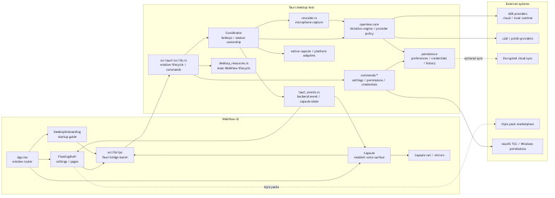
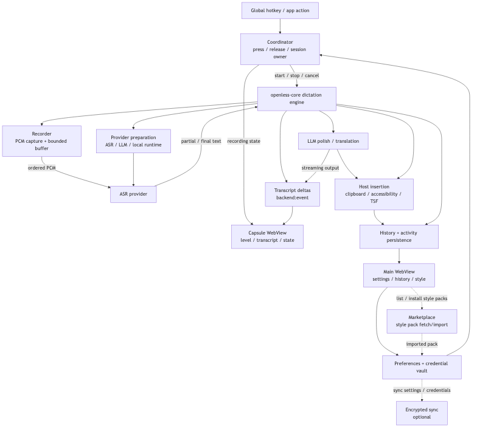
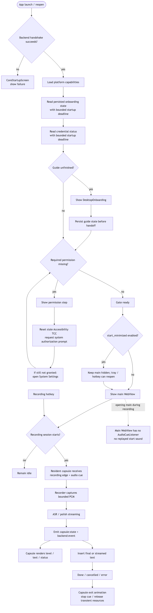

<p align="center">
  
</p>

<h1 align="center">OpenLess</h1>

<p align="center">
  <strong>面向 macOS、Windows、Linux、Android、iOS 与 HarmonyOS 的开源语音输入工具</strong>
</p>

<p align="center">
  按住快捷键说话，经 AI 润色的文本会实时插入到光标处——<br/>
  以<em>你</em>选择的写作风格呈现。
</p>

<p align="center">
  <a href="https://openless.top"><strong>官网</strong></a>
  &nbsp;·&nbsp;
  <a href="https://github.com/Open-Less/openless/releases/latest"><strong>下载</strong></a>
  &nbsp;·&nbsp;
  <a href="README.md">English</a>
  &nbsp;/&nbsp;
  <a href="README.zh.md">中文</a>
</p>

<p align="center">
  <a href="https://github.com/Open-Less/openless/releases/latest"></a>
  <a href="https://github.com/Open-Less/openless/blob/main/LICENSE"></a>
  <a href="https://github.com/Open-Less/openless/stargazers"></a>
</p>

<p align="center">
  
  
  
  
  
  
  
  
</p>

<p align="center">
  QQ 一群&nbsp; <strong>1078960553</strong>（已满员） &nbsp;·&nbsp; QQ 二群&nbsp; <strong>1095794054</strong>
</p>

<br/>

<h2 align="center">赞助商</h2>

<p align="center">
  <em>OpenLess 的持续发展离不开赞助商的慷慨支持。</em>
</p>

<p align="center">
  <a href="https://www.mivra.dev/" target="_blank" rel="noopener">
    
  </a>
  <br/>
  <a href="https://www.mivra.dev/" target="_blank" rel="noopener">Mivra (mivra.dev)</a>
</p>

<p align="center">
  Mivra 提供云服务器与裸金属服务器，节点覆盖香港与美国，另有游戏云服务与按需配置，为中小企业提供稳定、可靠的算力。
</p>

<h2 align="center">开发者</h2>

<table align="center">
  <tr>
    <td align="center" width="170">
      <br/>
      <strong><a href="https://tripmc.top/" target="_blank" rel="noopener">TRIP</a></strong><br/>
      <sub>作者</sub>
    </td>
    <td align="center" width="170">
      <br/>
      <strong><a href="https://github.com/H-Chris233" target="_blank" rel="noopener">Chris233</a></strong><br/>
      <sub>作者 / 维护者</sub>
    </td>
    <td align="center" width="170">
      <br/>
      <strong><a href="https://bigsong.site" target="_blank" rel="noopener">bigsong</a></strong><br/>
      <sub>贡献者 / 测试</sub>
    </td>
  </tr>
  <tr>
    <td align="center" width="170">
      <br/>
      <strong><a href="https://github.com/HKLHaoBin" target="_blank" rel="noopener">HKLHaoBin</a></strong><br/>
      <sub>Android 端作者 / Android 维护者</sub>
    </td>
    <td align="center" width="170">
      <br/>
      <strong><a href="https://github.com/Cooper-X-Oak" target="_blank" rel="noopener">Cooper</a></strong><br/>
      <sub>贡献者</sub>
    </td>
    <td align="center" width="170">
      <br/>
      <strong><a href="https://github.com/aeoform" target="_blank" rel="noopener">aeoform</a></strong><br/>
      <sub>贡献者 / Linux 维护者</sub>
    </td>
  </tr>
</table>

OpenLess 是一个跨平台（macOS、Windows、Linux、Android、iOS 与 HarmonyOS）语音输入应用，是 [Typeless](https://www.typeless.com/)、[Wispr Flow](https://wisprflow.ai)、[Lazy](https://heylazy.com)、Superwhisper 等商业工具的全开源替代方案。官网：[openless.top](https://openless.top)。

原生 [iOS 应用与键盘](openless-all/ios/README.md) 位于 `openless-all/ios/`，支持中英文输入、语音优先与按住空格两种模式，以及语音翻译；源码构建与个人签名步骤见 iOS 指南。鸿蒙宿主位于 `openless-all/app/harmony/`，仍在适配中：HAP 已可构建，输入法扩展也已接入共享的 ASR/润色管线，但真实联网识别与商店分发仍需真机验收。

把光标放在任意输入框——ChatGPT、Claude、Cursor、Notion、邮件草稿、聊天框——按一个全局快捷键说话。OpenLess 录制音频、转写、按你选择的模式润色，然后把结果插入到光标处。如果插入被阻挡，文本会被复制到剪贴板，你说的话不会丢失。

与只会输出逐字稿的听写工具不同，OpenLess 的看家本领是 **AI 提示词模式**：你自由口述，它为你补上结构、捕捉约束条件，产出可以直接粘贴进 ChatGPT、Claude 或 Cursor 的、上下文完整的提示词。

## 平台支持

六个宿主共享同一个与框架无关的后端（`openless-core`），差别在于接入 Core 的程度以及打包分发方式。

| 平台 | 宿主 | 现状 | 分发 |
| --- | --- | --- | --- |
| macOS 14 Sonoma+ | Tauri 2 + React（`src-tauri/`） | 完整桌面应用：快捷键、插入、历史、风格包、光标上下文、Apple Speech、实验性本地 ASR | DMG（Apple Silicon / Intel）、Homebrew Cask |
| Windows 10+ | Tauri 2 + React（`src-tauri/`） | 完整桌面应用，另有原生 TSF 输入法（`windows-ime/`）与 Foundry/sherpa 本地 ASR | NSIS 安装包 |
| Linux | 原生 egui/eframe 宿主（`linux-egui/`，不依赖 Tauri 或 WebKitGTK） | Core 2.0 服务已接到原生界面；L01–L12 真机验收尚未完成 | 源码构建；验收通过后才提供 deb/rpm |
| Android 8.0+ | Tauri 移动宿主 + React、OpenLess 键盘（`android/`、`mobile-ime/`） | 应用、悬浮胶囊、输入法、光标上下文、应用内更新 | 按 ABI 分发的 APK |
| iOS 16+ | 原生 SwiftUI/UIKit 应用、键盘扩展、录音小组件（`openless-all/ios/`） | 中英文输入、语音优先与按住空格模式、语音翻译 | 源码构建的未签名 IPA，个人签名 |
| HarmonyOS（API 12+） | ArkTS + ArkWeb 宿主与输入法扩展（`harmony/`、`harmony/rust`） | 宿主、输入法与语音管线已打通；联网识别、更新流程与上架仍在进行 | Release 中的未签名 HAP |

## 从工具到基础设施

先进系统的共同点是：**它们把今天的沟通方式，变成明天默认的规则。** 互联网胜出，不是因为 HTTP 更快，而是因为再没有人需要协商数据如何传输；Git 胜出，不是因为代码更好，而是团队不再每天协调版本；Stripe 胜出，不是因为支付更快，而是开发者不再和银行来回协调。

OpenLess 做的事不是「更快的听写」，而是**消除从想法到干净文本之间每一次协调动作。** 把脑子里的东西变成可用文本，过去意味着反复做决定：这一句用什么语气？那个名字怎么拼？贴在哪个输入框，复制还是粘贴？模型的密钥放在哪、谁能访问？OpenLess 把那些重复的协商**层层沉淀**为默认值：

- **语气**沉淀为**风格包**——有名字、可切换、一个快捷键即生效，不再重复决定。
- **专有名词**沉淀为**词典热词**——ASR 能识别、润色模型有提示，不再反复纠正。
- **文本落到哪里**沉淀为**统一的插入协议**——按住、说话，文本出现在光标处，失败时自动回退到剪贴板。
- **模型与凭据**沉淀进**系统保险库**——启动时授权一次，之后不再协商。

这就是**「在启动时一次性授权基础设施」**的含义：首次运行时，麦克风、辅助功能与云端凭据各授权一次；从那一刻起，「说话 → 干净文本出现在光标处」不再是你每次都要跑的协商，而是一个可以彻底忘掉的默认协议。评判 OpenLess 的标准不是它快了多少，而是它**消除了多少协调。**

## ✨ 新增能力

以下能力把过去每天重复的协调，继续沉淀为默认值：

- 📖 **会学习的词典。** 过去词典只认识你手打进去的词。现在，当你改正 OpenLess 刚写出的某个词时，它会用小卡片问你一次是否记住，一键即可加入。配合**光标上下文**（可选，macOS / Windows）——让润色模型读取光标周围的文字——OpenLess 不再是靠猜同音字的转写器，而是懂你词汇的输入法。所有建议都经过你确认，不会有任何静默学习。
- 🎨 **风格包 Marketplace。** OpenLess 不再只有一种固定的「润色」声音。你可以用自定义系统提示词构建**风格包**、用快捷键切换、**一键安装社区风格包**，也可以发布自己的风格包分享出去。当风格贴合你的具体任务（冷邮件、提交信息、小红书文案、正式报告、团队语气）时，输出不只是更干净，而是*明显更好*，因为模型终于按你期望的方式在写。
- ⚡ **流式插入。** 文本在润色过程中**逐字**流向光标，不必等待完整结果。感知延迟显著下降，听写几乎和思考一样快；当应用无法接收流式按键时，会自动回退为一次性粘贴。

## 一个具体例子

按住快捷键说：

> 呃……那个，我需要回复客户上次发来的方案，我们内部讨论过了，整体方向没问题，但有几个细节要改。第一是交付周期太紧，我们想往后推两周；第二是预算，他们报的价比我们预期高了大概百分之二十，能不能谈谈；另外我们总体是愿意合作的，安抚一下他们，语气保持礼貌，别太生硬。

松开快捷键。片刻之后，你的输入框里是：

```text
回复客户关于其上次发来的方案。内部讨论后，整体方向没有问题，但有以下几点需要调整：

1. 交付周期
   （a）当前周期过紧，希望延长两周。
2. 预算
   （a）对方的报价比我们预期高约 20%，是否可以重新协商？
请整体上表达对合作持积极态度，语气保持礼貌，不要过于生硬。
```

无需再编辑——直接粘贴进 ChatGPT 或 Claude 让它起草邮件。核心思路就一句话：**用说话来写提示词，比打字更快、更干净。**

## 为什么 OpenLess 要开源

最接近的替代品是订阅制 SaaS：按月付费、不能自带模型、音频上传到厂商、词典和习惯存在对方的账号里。

OpenLess 追求同样的终端体验，但：

- **完全开源、本地优先。** 代码就在这个仓库里，你的所有数据都留在你自己的机器上。
- **自带云端凭据。** 近三十个 ASR 渠道、二十多个润色渠道——火山引擎、讯飞、阿里云百炼、阶跃星辰、OpenAI 兼容端点等等——或者任何你自己接入的端点。没有厂商锁定。
- **为 AI 提示词调优。** 结构化模式把松散的口语重塑为带有上下文、约束和请求的提示词，可直接粘贴进 ChatGPT、Claude 或 Cursor。
- **它不会替你回答。** 模型只整理你的文本。你说「这个应用还缺什么功能？」，它回给你一个干净的问题——而不是一份功能清单。要那份清单，去问 AI 本身。

## 使用场景

- **为 ChatGPT / Claude / Cursor / Gemini 写提示词**——口述需求，OpenLess 把它变成结构化、有细节的提示词。
- **起草邮件、需求文档、长 Slack 或微信消息**——去掉口水话、修正标点、组织段落。
- **代码注释、提交信息、PR 描述**——在光标处直接捕捉你的想法。
- **任何场合**：你必须产出书面文字，却不想打字。

## 风格包与 Marketplace

**风格包**是带系统提示词的具名输出风格。你不再被单一的内置「润色」声音限制，可以精确塑造口述内容被渲染的方式——风格越贴合真实任务，结果越好。

- **创建与自定义。** 在 **Style** 页面新增风格包，写自定义系统提示词（例如「简洁的工程提交信息」「温暖的客服回复」「带 emoji 的小红书文案」），用快捷键切换当前风格。
- **从社区安装。** 打开 **Marketplace** 浏览、搜索并一键安装别人分享的风格包，给好用的包点赞。
- **发布你自己的。** 用 GitHub 身份登录（设置 → Marketplace），然后在 Style 页面选择 **发布到 Marketplace**。上传内容经审核后才会公开。

Marketplace 由 OpenLess 自有的审核后台上线服务，因此目录始终保持精选，而不是无人管理的自由集市。

## 项目定位

OpenLess 只做一件事：**把语音变成可用的书面文本——尤其是 AI 提示词——插入到当前光标处。**

- 它不回答问题、不执行任务、不分析你的项目。
- 它不累积对话上下文；每次听写都是独立的清理请求。
- 管线是：语音 → 转写 → 清理 → 插入光标处，失败时回退到剪贴板。
- 其余一切（模式、词典、历史、菜单栏、概览统计）都是为了服务这一条路径。

## 稳定性冻结

OpenLess 现阶段优先修复语音输入的稳定性与体验。录音、转写、历史恢复和最终写入等链路的修复，以及兼容性、测试、文档和小范围体验改进仍可提交。不接收范围外新功能、大规模后端重写或批量功能改动。

当前只保留以下产品工作：优化语音提示词及缓存命中率；支持上一条胶囊处理时启动下一条录音；支持口述期间显式添加文字、链接、截图和附件，并保留它们在口述中的位置；优化热词表与识别准确率。

按新增与删除行数之和计算，超过 1,000 行酌情审查，超过 2,000 至 4,000 行原则上暂缓合并或单独复核。自 2026 年 11 月 21 日起一个月内，超过 4,000 行的 PR 不予合并并关闭，请拆分后再提交。详见[维护公告](https://github.com/Open-Less/openless/issues/1479)。

## 对比

| 工具 | 形态 | OpenLess 的不同 |
| --- | --- | --- |
| [Typeless](https://www.typeless.com/) | 闭源 macOS / Windows / iOS，订阅制 | 开源；显式 AI 提示词模式；自带 ASR + LLM；数据与词典留在你的机器上——包括词典从你的纠正中学到的东西，它从不上传，也未经你确认绝不会被加入 |
| [Wispr Flow](https://wisprflow.ai) | 闭源 macOS / Windows，订阅制 | 开源；自带 ASR + LLM；透明的提示词处理规则 |
| [Lazy](https://heylazy.com) | 闭源笔记 / 捕获工具 | 不是笔记容器——直接插入到任意输入框 |
| [Superwhisper](https://superwhisper.com) | 闭源 macOS，订阅制 | 开源；默认云端 ASR，macOS 与 Windows 上另有实验性的端侧 ASR |

## 功能现状

下面每一项都是又一层沉淀为默认值的能力——授权一次，此后无需再管理。这是启动之后你脚下站立的基础设施：

- 共享的 Rust 后端位于 `openless-core`。macOS、Windows 与 Android 使用轻薄的 Tauri 2 宿主加 React/TypeScript 前端；Android 另有原生键盘，Windows 另有 TSF 输入法。Linux 使用独立的原生 egui 宿主，从不编译 Tauri 或 WebKitGTK。iOS 运行原生 SwiftUI/UIKit 应用并带键盘扩展，HarmonyOS 运行 ArkTS/ArkWeb 宿主，通过同一套 napi 暴露的 Core 工作。
- 🎨 **风格包 Marketplace**——在应用内 Marketplace 浏览、安装、点赞社区的**风格包**，也可以发布自己的（每个包一份自定义系统提示词，快捷键切换）。后端经过审核，上传内容公开前会先审核。
- ⚡ **流式插入**——润色文本逐字写入光标以降低感知延迟，并有自动回退到一次性粘贴的机制。在 设置 → 录音 中开关。
- **切换式与按住说话式**两种录音模式，另支持 **MediaPlayPause 触发**，让有线耳机线控也能开始/结束录音。任意阶段按 `Esc` 都可以取消，包括润色与插入阶段。
- **云端 ASR**：火山引擎流式 ASR（bigasr）、腾讯云混元实时 ASR（Hy-ASR）、讯飞实时 ASR（RTASR）、阿里云百炼（经典实时 / Qwen3 实时 / Fun-ASR-Flash 文件转写）、阶跃星辰 StepAudio（批量 + 实时）、智谱 GLM-ASR、小米 MiMo ASR、OrcaRouter 音频输入 Gemini、ElevenLabs Scribe、OpenAI 兼容批量转写（OpenAI Whisper / Groq / SiliconFlow SenseVoice / OpenRouter / ZenMux），以及 Apple Speech（macOS）。
- **本地 ASR**：Windows 上的 Foundry Local Whisper 与 sherpa-onnx（实验性）。macOS 上旧的本地模型管理已下架，改为 设置 → 实验与扩展 中的三个实验：TextStream（Qwen3-ASR on MLX，约 1.9 GB，Apple Silicon，macOS 14+）、SenseVoice Small（约 240 MB）、Embedding Gemma（约 715 MB，Apple Silicon，macOS 15+）。模型按需下载，不随安装包分发。
- **润色渠道**：Ark（火山引擎）、DeepSeek、OpenAI、Google Gemini、Codex OAuth、SiliconFlow、Atlas Cloud、小米 MiMo、腾讯云 TokenHub、CometAPI、OpenRouter、Requesty、API Route、OrcaRouter、阿里云 Coding Plan、CodingPlanX、MiniMax、阶跃星辰，以及 OpenCode Zen——外加上你自带的任意 OpenAI 兼容端点。
- **四种输出模式**：原文、轻度润色、清晰结构（**AI 提示词模式**）、正式表达。另有**翻译快捷键**，把口述内容直接转成配置的目标语言（[#43](https://github.com/Open-Less/openless/issues/43)）。
- **划词提问 QA 面板**——另一个快捷键会打开悬浮面板，对任意应用中选中的文本做语音问答（[#118](https://github.com/Open-Less/openless/issues/118)）。
- **主窗口**：概览 / 历史 / 词典 / 风格 / Marketplace / 设置。常驻托盘图标，以及一个跟随你正在输入的显示器（多屏）的迷你状态胶囊。
- **本地模型管理**——在设置中管理磁盘上的本地 ASR 模型存储。
- **多语言界面**——设置 → 语言 可在 简体中文 / 繁體中文 / English / 日本語 / 한국어 / Español / Français / Deutsch 之间切换（首次启动自动检测）。
- **Tauri 宿主上的应用内自动更新**——设置 → 关于与更新 → 检查更新；macOS、Windows 与 Android 通过 Tauri updater 插件提供已签名更新产物。Linux deb/rpm 没有应用内更新或 AppImage 清单，鸿蒙构建目前也还没有更新流程。
- **Beta 通道（需主动开启）**——设置 → 关于与更新 → 加入 Beta 通道会切换到 Beta 更新源；安装包也可从 Releases 获取。Beta 版本不会自动触达 Stable 用户（见[贡献流程](#贡献流程)）。
- **分发渠道**——[Releases](https://github.com/Open-Less/openless/releases) 直链 DMG/EXE、Homebrew Cask（需先添加 tap，见下方安装说明）、按 ABI 分发的 Android APK，以及未签名的鸿蒙 HAP。Linux deb/rpm 需要独立的真机验收并由管理员显式上传到既有 Release；iOS 从源码构建、用个人团队签名。
- **单实例锁**——防止两个 OpenLess 进程争抢同一个快捷键沿。
- 词典词条会作为火山引擎 ASR 的 `context.hotwords` 注入，并在润色阶段作为语义提示；命中数按会话累计。
- 平台原生全局快捷键：macOS 用 CGEventTap，Windows 用低级键盘钩子（`WH_KEYBOARD_LL`）。

## 下载与安装（终端用户）

前往 [Releases](https://github.com/Open-Less/openless/releases) 下载：

- **macOS**（要求 macOS 14 Sonoma 或更新）：`OpenLess_<version>_aarch64.dmg`（Apple Silicon）或 `OpenLess_<version>_x64.dmg`（Intel）。打开后把应用拖到 `/Applications`，**然后在终端执行一次以下命令以绕过 Gatekeeper 的「已损坏」提示**（构建为 ad-hoc 签名，未做 Apple 公证）：
  ```bash
  xattr -cr /Applications/OpenLess.app
  ```
- **Windows**：`OpenLess_<version>_x64-setup.exe`——运行安装程序。
- **Android**（正式 APK 在 GitHub Release；调试 APK 走 Actions 产物）：
  - **手机（推荐）**：`OpenLess_<version>_arm64-v8a.apk`
  - **较老的 32 位 ARM**：`OpenLess_<version>_armeabi-v7a.apk`
  - **64 位模拟器**：`OpenLess_<version>_x86_64.apk`
  - **32 位模拟器**：`OpenLess_<version>_x86.apk`
  - 应用内更新（设置 → 关于与更新）读取 `https://dl.aeoform.com/updates/stable/latest-android-{arch}.json`；Beta 用户需在高级设置中加入 Beta，读取对应的 `.../updates/beta/latest-android-{arch}-beta.json`。
  - 调试冒烟包：workflow_dispatch 产物中的 `OpenLess-android-debug-{abi}-*.apk`。
  - 拿不准时，执行 `adb shell getprop ro.product.cpu.abi` 选择匹配的 APK。
- **Linux**：Tauri/WebView 版本已退役。原生 `eframe` 宿主使用共享的 Core 2.0 服务。在 CI 与真实 Ubuntu 上的音频、输入、安装、升级与回滚验收通过后，共享 Release 会包含 deb/rpm 包与 `SHA256SUMS`。Linux 需要 glibc ≥ 2.39（Ubuntu 24.04 或同级发行版）；没有 AppImage，也没有应用内更新。
- **HarmonyOS**（适配中）：从同一个 Release 下载 `OpenLess_harmony_arm64.hap`。它是未签名包，供开发者/测试人员通过 DevEco Studio 或 `hdc` 安装；AppGallery 分发包由工作流生成但需人工提交，目前还没有更新流程。本地构建与签名步骤见 `openless-all/app/harmony/README.md`。
- **iOS**：没有可下载的 IPA。请从源码构建原生应用并用你自己的团队签名——bootstrap、构建与开启键盘的步骤见 [openless-all/ios/README.md](openless-all/ios/README.md)。
- **macOS（Homebrew）**：
  ```bash
  brew tap Open-Less/openless https://github.com/Open-Less/openless
  brew install --cask openless
  xattr -cr /Applications/OpenLess.app

  # 升级到最新版本
  brew update && brew upgrade openless
  ```

首次启动时，请授予应用请求的权限。

**macOS：**
1. 授予麦克风权限。
2. 授予辅助功能权限。
3. **退出并重新打开应用**——辅助功能权限重启后才生效。
4. 打开设置，填入你的火山引擎 ASR + Ark 凭据。

**Windows：**
1. 出现提示时授予麦克风权限。
2. 打开 设置 → 权限与数据，确认全局快捷键监听已生效。
3. 在设置中填入你的火山引擎 ASR + Ark 凭据。

完整的终端用户操作说明见 [USAGE.zh.md](USAGE.zh.md)。

## 从源码构建（开发者）

活跃工作区位于 `openless-all/app/`。`crates/openless-core` 是与框架无关的后端；`src-tauri` 承载 macOS/Windows/Android，`linux-egui` 是原生 Linux 界面及其平台适配层，`harmony/` 是 ArkTS/ArkWeb 宿主加上 `harmony/rust` napi crate，`openless-all/ios/` 是独立的原生 iOS 工程。本地化的 crate（`cpal`、`tauri-runtime-wry`）直接签入 `src-tauri/vendor/`，因此**无需初始化 Git 子模块**。根 Core/Linux 工作区排除了 `src-tauri`，所以它独立的检查不会解析 Tauri 清单。建议先看[文档索引](docs/index.md)、[架构](docs/architecture.md)与[源码结构](docs/structure.md)。

Rust 1.99 是所有源码树（`openless-core`、`src-tauri`、`linux-egui`）的最低支持工具链，推荐使用最新稳定版 Rust。CI 在 macOS 与 Windows 上同时验证 Rust 1.99 与 stable，Linux egui 宿主验证 stable，并同时构建 Android、iOS 与 HarmonyOS 宿主。

```bash
cd "openless-all/app"
npm ci

# macOS/Windows/Android：Vite 在 :1420 + Tauri 宿主
npm run tauri dev

# Android 正式 APK——先跑初始化/脚手架/manifest 链路（src-tauri/gen/android 是生成的），
# 见 openless-all/README.zh.md 的「Android 构建」
npm run tauri:android:build:release

# macOS 正式构建（签名、安装、重置 TCC）
./scripts/build-mac.sh
INSTALL=0 ./scripts/build-mac.sh   # 只构建，不安装

# HarmonyOS HAP（需要 HarmonyOS Command Line Tools；见 harmony/README.zh.md）
bash scripts/build-harmony-frontend.sh

# 共享后端与 Linux 宿主/界面（不编译 Tauri/WebKitGTK）
cargo check -p openless-core
cargo check -p openless-linux-egui --all-targets

# Tauri 宿主类型检查
cargo check --manifest-path "src-tauri/Cargo.toml"

# 前端 TypeScript 检查
npm run build
```

日志：`~/Library/Logs/OpenLess/openless.log`（macOS）/ `%LOCALAPPDATA%\OpenLess\Logs\openless.log`（Windows）。

**Windows 构建**——MSVC 与 GNU/MinGW 两条路线见 [`openless-all/README.zh.md`](openless-all/README.zh.md)。

## 贡献流程

OpenLess 采用双通道分支模型。

- **`beta`**——**Beta 通道**。默认分支与集成分支，所有进行中的开发都落在 `beta` 上。Beta 构建可能存在，但**不会推送给普通用户**——只有主动加入 Beta 通道的人才会收到。
- **`main`**——**Stable 通道（正式版）**。始终保持可发布状态，是所有人默认收到的版本。

```text
你的 fork / 议题分支
        │  （先在目标平台上本地测试）
        ▼
   PR → beta  ← AI 审查（一次，仅作建议）
        │     ← 维护者轻量浏览（范围、跨模块影响）
        ▼
       合并进 beta
        │  （定期，在双平台冒烟构建通过后）
        ▼
       合并进 main  →  打 tag `v<version>-tauri`  →  发布 CI → Stable 用户
```

经验规则：

- **PR 一律对着 `beta`，绝不对着 `main`。** GitHub 已经默认把新 PR 的 base 分支设为 `beta`。
- **开 PR 前先在目标平台验证改动**——构建通过是必要条件，还须人工验证。
- **AI 审查每个 PR 只跑一次，且仅作建议。** 不要围着它反复打转，自己判断。
- **AI 返工轮次保持紧凑（1–2 轮）。** 若修改卡住，找人协助或用全新上下文重来——多轮 AI 来回通常弊大于利。
- **Beta 的工作不得泄漏到 Stable。** `main` 只接受来自 `beta` 的合并，由维护者在双平台冒烟构建成功后执行，不允许直接推 `main`。
- **正式版从 `main` 切出**：推送 `v<version>-tauri` tag——见下方维护者发布清单。

Beta 版本分发（需手动下载开启）：应用内更新器的 Stable 通道只读取 Stable 清单路径，因此普通用户永远不会通过自动更新收到 Beta 构建。想尝试 Beta 的用户打开 **设置 → 关于与更新**，开启「加入 Beta 通道」，再从应用获取的 GitHub 链接手动下载最新 Beta 安装包。tag 约定：`v<version>-Beta.<N>-tauri` 产出 Beta 版本（标记为 GitHub pre-release），`v<version>-tauri` 产出正式版。

更新清单由项目 CDN 提供，每个平台、每个通道一个滚动文件：

```text
https://dl.aeoform.com/updates/stable/latest-{target}-{arch}.json
https://dl.aeoform.com/updates/beta/latest-{target}-{arch}-beta.json
```

通道的区隔在 URL 路径（`/updates/stable/` 与 `/updates/beta/`），因此 Stable 客户端即使请求了错误的 URL 也拿不到 Beta 清单。清单内的产物 URL 指向同一个 CDN（`https://dl.aeoform.com/releases/{tag}/{asset}`），这是中国大陆用户实际下载的来源。清单由发布工作流生成为运行产物，**不**附加在 GitHub Release 上，因此构建后须由维护者上传到 CDN——见 `RELEASING.md`。在此切换之前构建的客户端读取旧的 `releases/latest/download/latest-*.json` 资产，因此无法自动更新到最后一个仍带这些资产的版本之后，需要手动下载一次。

## 凭据

凭据存放在操作系统凭据保险库中（service = `com.openless.app`）：macOS 钥匙串、Windows 凭据管理器，或 Linux keyring。旧的明文 JSON 文件仅作为迁移来源读取，写入保险库成功后即删除：

```text
macOS / Linux: ~/.openless/credentials.json
Windows:       %APPDATA%\OpenLess\credentials.json
```

新的凭据写入不再持久化明文密钥。仓库中不含任何 API key、token 或私有端点。

你需要准备：

- **火山引擎流式 ASR**：APP ID、Access Token、Resource ID。
- **讯飞实时 ASR（RTASR）**：AppID、API Key。见 [docs/xfyun-asr.md](docs/xfyun-asr.md)。
- **Ark 润色**：API Key、Model ID、Endpoint。Ark 默认端点为 `https://ark.cn-beijing.volces.com/api/v3/chat/completions`。

## 提示词处理原则

OpenLess 的润色模型只重塑文本，不回答问题、不执行任务、不分析你的项目。每次听写都是独立请求，提示词会明确要求模型：

- 该输入与任何先前对话相互隔离。
- 原始转写稿是待清理的文本，不是要回答的问题。
- 即使输入中包含问题或命令，也不要回答或执行。
- 只输出清理后的文本，不要「以下是清理后的版本」之类的开场白。

例如，用户说「这个应用还缺什么功能」，正确的输出是：

```text
这个应用还缺什么功能？
```

……而不是一份功能缺失清单。

长期参考改写以 `raw → polished → rule` 三元组的形式记录在 [docs/references/polish-reference-examples.sample.jsonl](docs/references/polish-reference-examples.sample.jsonl)。该示例格式描述参考数据；当前模块职责见[架构](docs/architecture.md)。

## 词典

词典处理你的专有名词、产品名、人名和新词。目前支持：

- 手动添加正确拼写、分类与备注。你不需要维护错误拼写或上下文提示。
- 已启用的词条会发送给支持热词的 ASR 渠道（火山引擎 `context.hotwords`、阶跃星辰 `hotwords`、Whisper 兼容的 `prompt`——但 ZenMux 除外，其 JSON 协议不承载 `prompt`/`hotwords`，以及百炼词表 ID），以便转写时正确识别。讯飞实时 ASR 没有请求级热词参数——请在讯飞控制台配置个性化热词。
- 词条也会注入润色提示词：模型逐句判断是否替换。如果「云」在上下文中明确指 AI 产品 `Claude`，就纠正；如果确实指云计算，就保持原样。
- **从纠正中学习（实验性）。** 打开 设置 → 实验与扩展 → 从纠正中学习 启用，并配置观察时长（10–60 秒，默认 60）、建议停留时长（5–60 秒，默认 10）与自动学习短语最大长度（2–32 字符，默认 12）。该功能默认关闭，不会因光标上下文或云同步而自动开启。在 macOS、Windows 与 Android 上，插入后可对受支持的编辑器进行观察。建议需在过期前确认才会进入词典。修改参数会停止当前观察并清空待处理建议；新参数在下次听写时生效。Android 需要无障碍权限。无法观察时，可在历史详情中使用 **记住一个词**；Android 输入法结果编辑也提供默认不勾选的词典项。每条路径都需要明确确认，且不会生成全局替换规则。
- **有产出的词条优先。** 发往 ASR 渠道的热词预算是有限的（几百个字符）。词条按命中次数排序，并为你刚手动添加的词保留少量席位，这样你真正在用的词能保住位置，而不是被最近添加的词挤掉。

### 光标上下文（可选，macOS / Windows / Android）

设置 → 隐私 → 数据存储 → **光标上下文**。默认关闭。

开启后，每次听写会读取**你正在写作的那个应用**里光标周围几百个字符，并随润色请求一起发送，让模型知道你正在写什么。中文同音字（接口/借口、大鱼/大禹）对声学模型无法区分，但放在上下文里一目了然。本地词汇学习有独立开关，不依赖光标上下文。被观察的文本不会发送给模型；只有你明确加入词典的词，才会按上述方式参与后续的 ASR 与润色请求。

在 Windows 上，光标上下文通过 UI Automation 从焦点文本控件读取：优先使用 `TextPattern2` 的插入符范围，对只支持折叠选区的前端控件回退到 `TextPattern` 选区。无法可靠定位插入符时会跳过而不是猜测——错误的上下文比没有更糟，且两种情况都不影响正常听写。

Chromium 系编辑器（VS Code、Electron 应用）只有在检测到活动辅助功能客户端后才会同步辅助功能树的插入符位置，因此默认设置下 UI Automation 读回的位置可能是旧的。在 VS Code 中把 `editor.accessibilitySupport` 设为 `on`（设置 → 搜索「accessibility support」，可能需要重载窗口）即可获得准确的光标上下文；其他有类似设置的 Electron 编辑器同理。普通 Chrome/Edge 文本框不需要这样做。

在 Android 上，OpenLess 键盘在开始录音的那一刻直接从自己的 `InputConnection` 读取插入符前后的文本——不涉及无障碍权限，只读一次、不重试。听写、速记和云笔记都用它来润色，但上下文只影响口语词怎么写：它绝不会被复制进笔记、历史、云笔记 webhook 或日志。使用云端润色模型时，它会作为润色请求的一部分发给该渠道。悬浮窗目前还不读取光标上下文。

光标上下文会排除密码框、macOS 安全输入、Windows UIA 密码控件、密码类或要求不做个性化学习的 Android 编辑器、已知密码管理器与终端。关闭后即停止为润色读取光标上下文；其他已授权的辅助功能（包括本地词汇学习与插入）独立工作。关闭词汇学习会停止观察并清空待处理建议。

主窗口组织为 概览 / 历史 / 词典 / 风格 / Marketplace / 设置，另有翻译、纠正、用量与速记视图。点击「新建」时，词典页签会打开独立的编辑窗口。概览页展示累计口述时长、累计字数、平均每分钟字数、预估节省时间与词典参与统计。

## 架构

应用由一个共享的后端接口与若干平台宿主组成：

```
React UI  ── Tauri Adapter (macOS/Windows/Android) ──┐
egui UI   ── Linux Adapter (no Tauri/WebKitGTK) ────┤
SwiftUI   ── iOS Adapter (native, KeyboardKit) ─────┼── openless-core
ArkTS UI  ── HarmonyOS Adapter (ArkWeb + napi) ─────┘
```

`openless-core` 负责稳定的 DTO、错误、语义事件、仓储、凭据契约以及面向宿主的功能接口。仅属于宿主的关注点——IPC、窗口、托盘、权限、更新器、keyring、fcitx5 与打包资源路径——由各适配层实现。旧的 React 命令/事件名保留在 Tauri 兼容适配层；Linux 在进程内直接调用类型化的 Rust 接口。见 [`docs/linux-egui-backend-contract.md`](docs/linux-egui-backend-contract.md)。

`v<version>-tauri` / `v<version>-Beta.N-tauri` 工作流在一次 Actions run 中构建 macOS、Windows、Android 与 HarmonyOS 宿主；HarmonyOS 附上未签名 HAP，Android 不再有独立的 tag 触发。Linux egui 打包是独立的手动工作流，在真机验收前保持暂停；验收通过后由管理员把验证过的 deb/rpm 包附到共享 Release。Beta 产物保持 draft 直到管理员发布。Linux 没有 AppImage，也没有应用内更新清单。

听写管线：`快捷键沿 → Recorder.start + ASR.openSession → [音频帧] → 快捷键沿 → Recorder.stop + ASR.sendLastFrame → 润色 → 插入 → History.save`。

### 客户端架构与流程

以下图示根据当前 `beta` 的客户端边界生成。每张 PNG 都配有一份可编辑的 Mermaid 源码与一个 SVG 版本。

#### 架构



[Mermaid 源码](docs/images/client-diagrams/openless-client-architecture.mmd) · [SVG](docs/images/client-diagrams/openless-client-architecture.svg) · [中文图](docs/images/client-diagrams/openless-client-architecture.zh-CN.png) · [中文 Mermaid](docs/images/client-diagrams/openless-client-architecture.zh-CN.mmd) · [中文 SVG](docs/images/client-diagrams/openless-client-architecture.zh-CN.svg)

#### 数据流



[Mermaid 源码](docs/images/client-diagrams/openless-client-data-flow.mmd) · [SVG](docs/images/client-diagrams/openless-client-data-flow.svg) · [中文图](docs/images/client-diagrams/openless-client-data-flow.zh-CN.png) · [中文 Mermaid](docs/images/client-diagrams/openless-client-data-flow.zh-CN.mmd) · [中文 SVG](docs/images/client-diagrams/openless-client-data-flow.zh-CN.svg)

#### 启动、权限与录音



[Mermaid 源码](docs/images/client-diagrams/openless-client-startup-recording-flow.mmd) · [SVG](docs/images/client-diagrams/openless-client-startup-recording-flow.svg) · [中文图](docs/images/client-diagrams/openless-client-startup-recording-flow.zh-CN.png) · [中文 Mermaid](docs/images/client-diagrams/openless-client-startup-recording-flow.zh-CN.mmd) · [中文 SVG](docs/images/client-diagrams/openless-client-startup-recording-flow.zh-CN.svg)

与这些图示配套的依赖与模块评审见 [`docs/images/client-diagrams/openless-client-dependency-module-review.md`](docs/images/client-diagrams/openless-client-dependency-module-review.md)。

贡献与发布规则见[贡献流程](#贡献流程)与 [Releasing](RELEASING.md)；模块职责与接线见[架构](docs/architecture.md)。

## 路线图

已规划但尚未交付：

- 跨会话风格记忆：润色逐渐学习你的语气（[#46](https://github.com/Open-Less/openless/issues/46)）。
- 片段（Snippets）：尚无界面与触发逻辑。
- 「粘贴上一次结果」快捷键。
- HarmonyOS：真实联网 ASR/润色的真机验收、更新检测与商店分发。
- Linux：完成 L01–L12 真机验收，恢复 deb/rpm 发布自动化。

## 维护者发布清单

[RELEASING.md](RELEASING.md) 是权威的发布流程，涵盖管理员权限、版本同步、平台验收、draft 产物、签名与更新器验证。新的 Beta tag 使用 `v<X.Y.Z>-Beta.<N>-tauri`；历史上的 `-beta-tauri` 后缀仅为兼容保留。

## 致谢

OpenLess 衷心感谢赞助商、开发者与贡献者，以及更广泛的 LinuxDo 社区。

感谢赞助商让项目得以持续投入，也感谢我们的开发者与贡献者构建、评审并改进 OpenLess。

OpenLess 同样认可并感谢 LinuxDo 社区开放、务实、对开发者友好的氛围。OpenLess 的许多想法、讨论与早期反馈，都受到 LinuxDo 所代表的更广泛开源精神的启发。

本致谢不表示任何官方背书或隶属关系。

## 第三方组件

概览页的年度活动热力图移植自 **Rare UI** 的 [GitHub Activity](https://rareui.com/components/githubactivity)
组件（Copyright (c) 2026 Swami Malode，MIT + Commons Clause，要求署名）。移植保留上游的布局、
周/月换算、悬浮提示和可展开面板，只把 GitHub 数据源换成本地听写统计。源码位于
`openless-all/app/src/components/ui/GitHubActivity.tsx` 与 `github-activity.css`。
同一署名也出现在「设置 → 关于与更新 → 组件来源」。

## 许可证

OpenLess 2.0 依据 [AGPL-3.0-only 许可证](LICENSE) 发布。
已发布的 1.x 版本仍按其原始 MIT 许可证提供。
