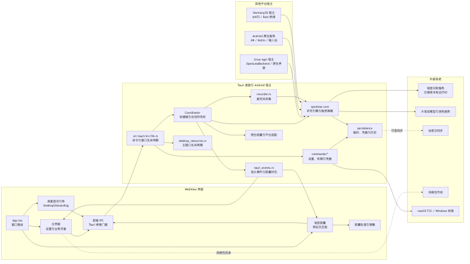
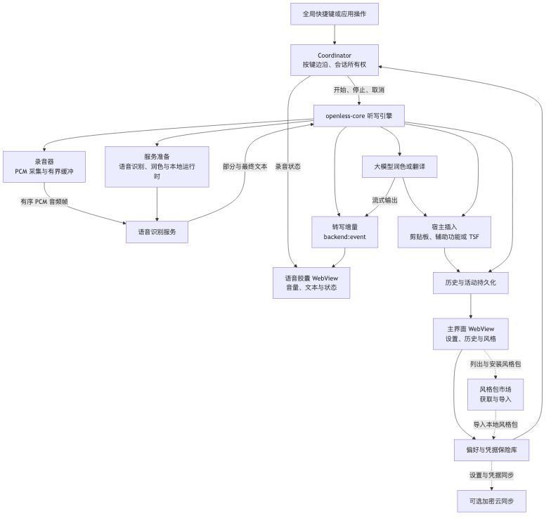
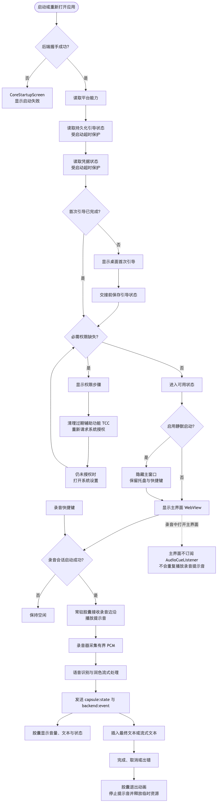

<p align="center">
  
</p>

<h1 align="center">OpenLess</h1>

<p align="center">
  <strong>面向 macOS、Windows、Linux、Android、iOS 与 HarmonyOS 的开源语音输入工具</strong>
</p>

<p align="center">
  按住快捷键说话，经 AI 润色的文本会实时插入到光标处——<br/>
  以<em>你</em>选择的写作风格呈现。
</p>

<p align="center">
  <a href="https://openless.top"><strong>官网</strong></a>
  &nbsp;·&nbsp;
  <a href="https://openless.top/zh/docs/"><strong>在线文档</strong></a>
  &nbsp;·&nbsp;
  <a href="https://github.com/Open-Less/openless/releases/latest"><strong>下载</strong></a>
  &nbsp;·&nbsp;
  <a href="docs/index.md"><strong>仓库文档</strong></a>
  &nbsp;·&nbsp;
  <a href="README.md">English</a>
  &nbsp;/&nbsp;
  <a href="README.zh.md">中文</a>
</p>

<p align="center">
  <a href="https://github.com/Open-Less/openless/releases/latest"></a>
  <a href="LICENSE"></a>
  <a href="https://github.com/Open-Less/openless"></a>
</p>

<p align="center">
  
  
  
  
  
  
  
  
</p>

<p align="center">
  QQ 一群&nbsp; <strong>1078960553</strong>（已满员） &nbsp;·&nbsp; QQ 二群&nbsp; <strong>1095794054</strong>
</p>

<br/>

<h2 align="center">赞助商</h2>

<p align="center">
  <em>OpenLess 的持续发展离不开赞助商的慷慨支持。</em>
</p>

<p align="center">
  <a href="https://www.mivra.dev/" target="_blank" rel="noopener">
    
  </a>
  <br/>
  <a href="https://www.mivra.dev/" target="_blank" rel="noopener">Mivra (mivra.dev)</a>
</p>

<p align="center">
  Mivra 提供云服务器与裸金属服务器，节点覆盖香港与美国，另有游戏云服务与按需配置，为中小企业提供稳定、可靠的算力。
</p>

<h2 align="center">开发者</h2>

<table align="center">
  <tr>
    <td align="center" width="170">
      <br/>
      <strong><a href="https://tripmc.top/" target="_blank" rel="noopener">TRIP</a></strong><br/>
      <sub>作者</sub>
    </td>
    <td align="center" width="170">
      <br/>
      <strong><a href="https://github.com/H-Chris233" target="_blank" rel="noopener">Chris233</a></strong><br/>
      <sub>作者 / 维护者</sub>
    </td>
    <td align="center" width="170">
      <br/>
      <strong>bigsong</strong><br/>
      <sub>贡献者 / 测试</sub>
    </td>
  </tr>
  <tr>
    <td align="center" width="170">
      <br/>
      <strong><a href="https://github.com/HKLHaoBin" target="_blank" rel="noopener">HKLHaoBin</a></strong><br/>
      <sub>Android 端作者 / Android 维护者</sub>
    </td>
    <td align="center" width="170">
      <br/>
      <strong><a href="https://github.com/Cooper-X-Oak" target="_blank" rel="noopener">Cooper</a></strong><br/>
      <sub>贡献者</sub>
    </td>
    <td align="center" width="170">
      <br/>
      <strong><a href="https://github.com/aeoform" target="_blank" rel="noopener">aeoform</a></strong><br/>
      <sub>贡献者 / Linux 维护者</sub>
    </td>
  </tr>
</table>

OpenLess 是一款跨平台（macOS、Windows、Linux、Android、iOS 与 HarmonyOS）开源语音输入工具，是 [Typeless](https://www.typeless.com/)、[Wispr Flow](https://wisprflow.ai)、Lazy 与 Superwhisper 等商业闭源产品的完全开源替代方案。官网与在线文档：**[openless.top](https://openless.top)**。

把光标放在任意输入框——ChatGPT、Claude、Cursor、Notion、邮件草稿或聊天窗口——按下全局快捷键开始说话。OpenLess 会完成录音、语音识别、按你选定的风格进行 AI 润色，并将干净的书面文本直接插入光标处；若应用拦截直接写入，会自动回退至剪贴板，绝不丢字。

## 平台支持

六个平台宿主共用同一套框架无关的 Rust 核心库（`openless-core`）：

| 平台 | 宿主实现 | 状态 | 分发方式 |
| --- | --- | --- | --- |
| **macOS 14 Sonoma+** | Tauri 2 + React（`src-tauri/`） | 完整桌面应用：快捷键、落字、连续输入、风格包、光标上下文、Apple Speech、实验性本地 ASR | DMG（Apple Silicon / Intel）、Homebrew cask |
| **Windows 10+** | Tauri 2 + React（`src-tauri/`） | 完整桌面应用，含原生 TSF 输入法（`windows-ime/`）与 Foundry / sherpa 本地 ASR | NSIS / MSI 安装包 |
| **Linux** | 原生 `egui` / `eframe` 宿主（`linux-egui/`，无 Tauri/WebKitGTK） | 已接通 Core 2.0 与 `fcitx5` 插件；真机验收进行中 | 源码构建（见 [Linux 宿主说明](docs/development/linux.md)） |
| **Android 8.0+** | Tauri 移动宿主 + React + OpenLess 键盘（`android/`、`mobile-ime/`） | 主应用、悬浮胶囊、输入法、光标上下文、应用内更新 | 按 ABI 提供 APK |
| **iOS 16+** | 原生 SwiftUI/UIKit 主应用、键盘扩展与小组件（`openless-all/ios/`） | 中英文输入、语音模式与长按空格听写、翻译、本地 SenseVoice | 源码构建与个人签名（见 [iOS 构建指南](openless-all/ios/README.zh.md)） |
| **HarmonyOS** | ArkTS + ArkWeb + napi Core（`app/harmony/`、`mobile-ime/`） | 适配中：可构建 HAP 且输入法已接入共享管线；真实联网与商店上架待验收 | Release 附未签名 HAP（见 [HarmonyOS 说明](openless-all/app/harmony/README.zh.md)） |

## 核心特性

- **三条语音与模型管线**：
  - **传统模式（ASR + 可选 LLM）**：支持近 30 个云端与本地 ASR 渠道（火山引擎、阿里云百炼、讯飞 RTASR、腾讯云混元、阶跃星辰、智谱 GLM、小米 MiMo、Whisper 兼容、Apple Speech 及 Foundry/sherpa/MLX 本地模型），可自由搭配 20+ 润色模型（火山方舟、DeepSeek、OpenAI、Gemini、OpenRouter 及任意 OpenAI 兼容端点）。
  - **多模态模式（单模型听写）**：由 Google Gemini、OpenAI Audio、阿里云 Qwen-Omni 等支持音频输入的模型一步完成转写与润色。
  - **DeepSeek 大统一**：使用 DeepSeek 官方 API Key 统一承接语音听写、问答、原生联网搜索与回答朗读。
- **连续听写与流式插入**：前一段录音刚结束即可继续说下一段，前序片段在后台异步处理并按原顺序写回对应输入框；润色结果支持逐字流式插入并具备剪贴板安全回退。
- **风格包、应用路由与 Marketplace**：内置原文、轻度润色、清晰结构（AI Prompt）与正式书面四种模式；支持自定义风格包、按前台应用自动切换，并在内置 **Marketplace** 一键安装社区精选风格包。
- **个人词典与可选光标上下文**：词条按命中优先级注入 ASR 热词与润色提示词；支持「从纠正中学习」（需逐条手动确认、绝不上传）与可选光标上下文（自动排除密码框、安全输入与终端），显著提升专有名词与同音字准确率。
- **手机远程输入与加密云同步**：通过局域网可信 HTTPS 用手机录音并输入到电脑光标处（[手机远程输入指南](docs/guides/remote-input.md)）；支持客户端端到端加密云同步偏好、密钥与历史记录。

## 一个具体例子

按住快捷键自然口述：

> 呃……那个，我需要回复客户上次发来的方案，我们内部讨论过了，整体方向没问题，但有几个细节要改。第一是交付周期太紧，我们想往后推两周；第二是预算，他们报的价比我们预期高了大概百分之二十，能不能谈谈；另外我们总体是愿意合作的，安抚一下他们，语气保持礼貌，别太生硬。

松开快捷键，在 **清晰结构（AI Prompt）** 模式下，输入框会直接得到：

```text
回复客户关于其上次发来的方案。内部讨论后，整体方向没有问题，但有以下几点需要调整：

1. 交付周期
   （a）当前周期过紧，希望延长两周。
2. 预算
   （a）对方的报价比我们预期高约 20%，是否可以重新协商？

请整体上表达对合作持积极态度，语气保持礼貌，不要过于生硬。
```

更多润色与改写前后对照见官网 **[openless.top/zh/docs/voice-input/](https://openless.top/zh/docs/voice-input/)** 与仓库样例 [docs/references/polish-reference-examples.sample.jsonl](docs/references/polish-reference-examples.sample.jsonl)。

## 稳定性冻结

OpenLess 现阶段优先保障语音输入核心链路的稳定性与体验（录音、转写、历史恢复、可靠落字、兼容性、测试与文档），暂缓范围外新功能与超大 PR，详见 [维护公告 #1479](https://github.com/Open-Less/openless/issues/1479)。

## 快速开始与文档入口

- **下载与安装**：[GitHub Releases](https://github.com/Open-Less/openless/releases/latest) · [官网安装指南](https://openless.top/zh/docs/installation/) · [中文使用指南（USAGE.zh.md）](USAGE.zh.md)
- **语音与模型服务配置**：[官网配置文档（openless.top）](https://openless.top/zh/docs/setup/) · [仓库入口说明](docs/guides/speech-services.md)
- **开发者全平台构建指南**：[openless-all/README.zh.md](openless-all/README.zh.md)（macOS / Windows / Linux / Android / HarmonyOS / iOS）
- **iOS 构建与签名指南**：[openless-all/ios/README.zh.md](openless-all/ios/README.zh.md)
- **Linux 原生 egui 宿主与接口说明**：[docs/development/linux.md](docs/development/linux.md)
- **仓库文档总目录**：[docs/index.md](docs/index.md)

## 架构与数据流

OpenLess 采用 **界面层（UI）→ 平台宿主层（Host）→ 共享核心层（`openless-core`）** 三层分层架构：

```text
React UI  ── Tauri 适配层（macOS / Windows / Android）──┐
egui UI   ── Linux 原生宿主（无 Tauri / WebKitGTK）─────┤
SwiftUI   ── iOS 原生应用与键盘（CoreHost）──────────────┼── openless-core
ArkTS UI  ── HarmonyOS 适配层（ArkWeb + napi）──────────┘
```

核心语音听写数据流（与 [openless.top/zh/docs/development/](https://openless.top/zh/docs/development/#架构) 及 [docs/architecture.md](docs/architecture.md) 一致）：

`全局快捷键 / 触发按钮 → Coordinator（会话所有权） → 麦克风 PCM 采集 → openless-core 听写引擎 → ASR+LLM / 多模态 / DeepSeek 大统一（结合应用风格包与个人词典） → 宿主安全落字 / 剪贴板回退 → 本地历史与统计`

- 连续多段输入在录音结束后立刻转入后台异步队列，冻结原目标应用与光标上下文，完成后按提交顺序写回。
- 所有第三方服务密钥均交由操作系统凭据库保存（macOS 钥匙串、Windows 凭据管理器、Linux Secret Service、iOS Keychain），绝不写入仓库或明文配置。
- 详细模块边界、跨层契约与各业务数据流见 **[docs/architecture.md](docs/architecture.md)**。

### 客户端架构与流程图

可编辑 Mermaid 源文件（`.mmd`）与导出版本（`.svg` / `.png`）见 [docs/images/client-diagrams/README.md](docs/images/client-diagrams/README.md)：

#### 客户端架构



[中文 Mermaid](docs/images/client-diagrams/openless-client-architecture.zh-CN.mmd) · [中文 SVG](docs/images/client-diagrams/openless-client-architecture.zh-CN.svg) · [English PNG](docs/images/client-diagrams/openless-client-architecture.png) · [English SVG](docs/images/client-diagrams/openless-client-architecture.svg)

#### 客户端数据流



[中文 Mermaid](docs/images/client-diagrams/openless-client-data-flow.zh-CN.mmd) · [中文 SVG](docs/images/client-diagrams/openless-client-data-flow.zh-CN.svg) · [English PNG](docs/images/client-diagrams/openless-client-data-flow.png) · [English SVG](docs/images/client-diagrams/openless-client-data-flow.svg)

#### 启动、权限与录音流程



[中文 Mermaid](docs/images/client-diagrams/openless-client-startup-recording-flow.zh-CN.mmd) · [中文 SVG](docs/images/client-diagrams/openless-client-startup-recording-flow.zh-CN.svg) · [English PNG](docs/images/client-diagrams/openless-client-startup-recording-flow.png) · [English SVG](docs/images/client-diagrams/openless-client-startup-recording-flow.svg)

## 贡献与发布

- **双渠道分支**：`beta` 为默认开发集成分支（Beta 渠道），`main` 为正式版分支（仅由维护者从 `beta` 合并）。所有 PR 请统一提向 `beta`。
- **更新器 CDN**：桌面端更新器清单托管在 `https://dl.aeoform.com/updates/{stable|beta}/latest-{target}-{arch}[-beta].json`，不附在 GitHub Release 资产中。
- **维护者发布清单**：[RELEASING.zh.md](RELEASING.zh.md)（[English](RELEASING.md)）详述管理员发布权限、五处版本号同步闸门、签名公证、HarmonyOS 渠道与发布说明署名规范。

## 路线图

- 跨会话风格记忆（[#46](https://github.com/Open-Less/openless/issues/46)）
- 文本片段（Snippets）界面与触发流程
- 「粘贴上一次结果」快捷键
- HarmonyOS：真实联网真机验收、更新检测与商店分发
- Linux：完成 L01–L12 真机验收并恢复 deb/rpm 发布自动化

## 致谢

OpenLess 衷心感谢赞助商、开发者与贡献者，以及更广泛的 LinuxDo 社区开放、务实、对开发者友好的开源精神。本致谢不表示任何官方背书或隶属关系。

## 第三方组件与字体署名

- **Rare UI**（Copyright (c) 2026 Swami Malode，[MIT + Commons Clause + Attribution](openless-all/app/public/licenses/rare-ui-LICENSE.txt)）：
  - 概览页年度活动卡片改编自 [GitHub Activity](docs/ATTRIBUTION.md#rare-ui-github-activity)
  - 密码输入框眼睛动效改编自 [Password Input](docs/ATTRIBUTION.md#rare-ui-password-input)
  - 轻量通知面板改编自 [Toast](docs/ATTRIBUTION.md#rare-ui-toast)
  - 「随便问」交互参考自 [AI Prompt Box & Streaming Response](docs/ATTRIBUTION.md#rare-ui-ai-prompt-box-and-streaming-response)
- **Open Runde 字体**：界面内置圆体字体依据 [SIL Open Font License 1.1](openless-all/app/public/licenses/open-runde-OFL.txt) 分发与署名。

完整的组件与字体署名说明见 **[docs/ATTRIBUTION.md](docs/ATTRIBUTION.md)**，亦可在应用内「设置 → 关于与更新 → 组件来源」查看。

## 许可证

OpenLess 2.0 依据 **[AGPL-3.0-only](LICENSE)** 许可证发布；已发布的 1.x 版本仍按其原始 MIT 许可证提供。
