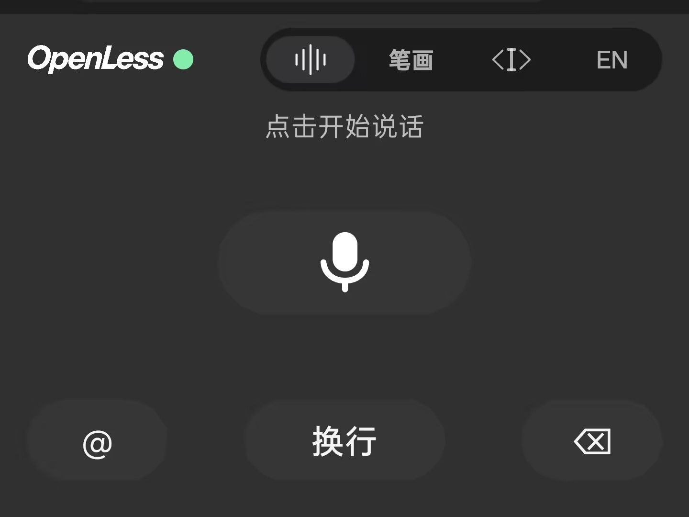
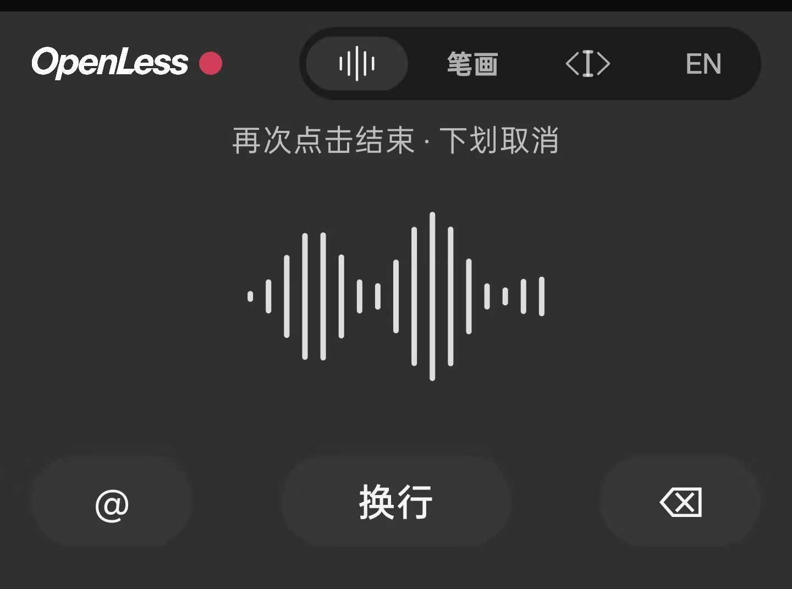
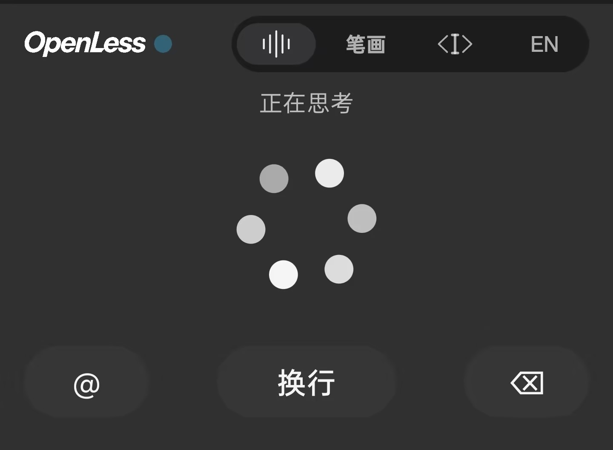
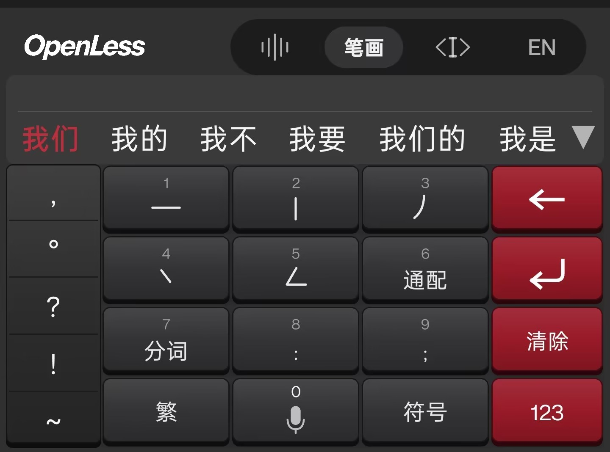
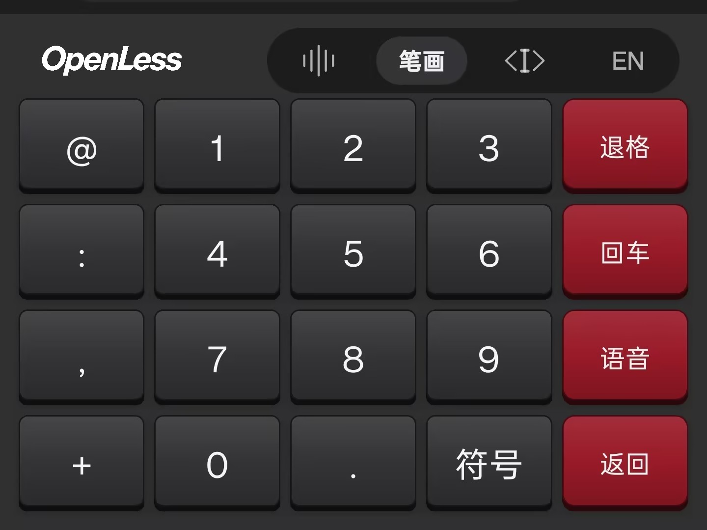
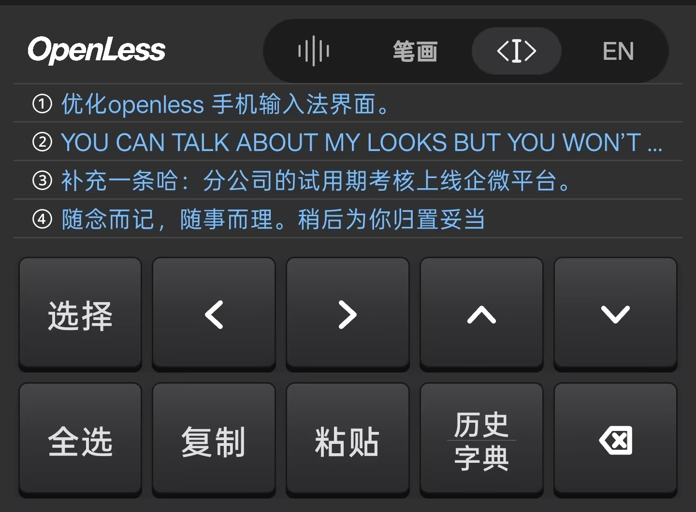
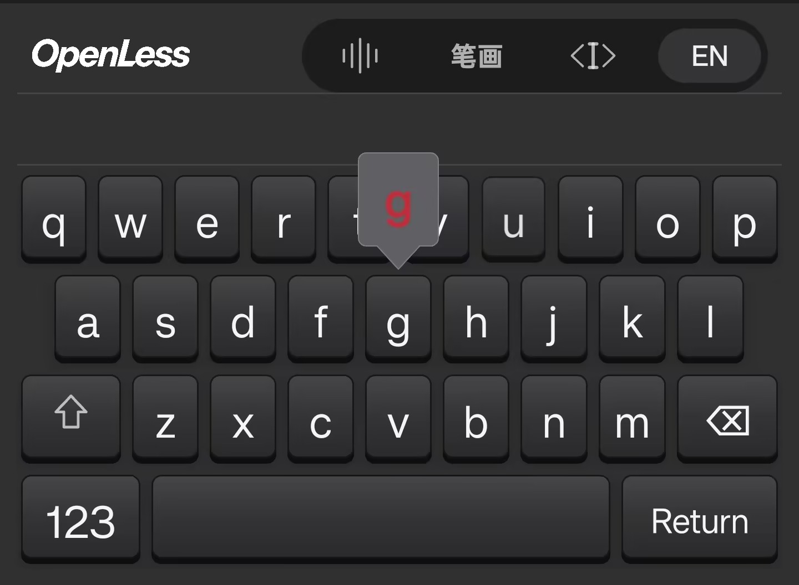

# OpenLess Android 输入法

构建、脚手架和源码定位见 [Android 平台指南](../openless-all/app/android/README.zh.md)。共享 Rime 引擎和词库维护见[移动端输入法后端](../openless-all/app/mobile-ime/README.zh.md)。

## 运行架构

`OpenLessImeService` 管理键盘面板与当前编辑器，通过 Android `InputConnection` 提交结果。`OpenLessRuntimeService` 监督 Rust/Tauri 后端的驻留和恢复。`OpenLessBackendWarmupActivity` 承载设置 WebView 与应用启动入口。与 Core 的语音、词汇和设备操作经 [`native_bridge.rs`](../openless-all/app/src-tauri/src/android/native_bridge.rs) 连接。

- **语音**支持录音、取消、草稿替换、原文和整理模式。草稿替换前核对原文本与编辑位置。
- **笔画与英文**在原生键盘提供离线候选、个人词频和数字／符号输入。笔画由 `StrokeInputController` 调度，英文由 `EnglishCandidateProvider` 提供排名。
- **拼音**由 `RimePinyinController` 接入共享 librime。候选提交经当前 `InputConnection` 确认后才通知引擎。密码框禁用拼音，禁止学习的编辑场景使用独立的无用户词典方案。
- **剪贴板**提供本机历史、收藏、筛选和粘贴。键盘数据导入导出与应用级迁移使用各自的格式。
- **手改学词**使用独立授权，默认关闭。原生无障碍观察只在同一编辑器与有界观察期内报告改动，Core 生成建议，用户明确确认后才加入词典。
- **光标上下文**在启用时由 `ImePrivacyPolicy.kt` 审核并有界采样。密码框、`TYPE_NULL`、禁止学习的输入框和敏感应用被排除。文本可作为当前听写、速记或云笔记润色的临时输入，历史、Webhook 和日志里没有这个字段。悬浮球与 IME 的采集路径各自验证。
- **跨应用插入**依次使用获准的无障碍、Shizuku 和剪贴板回退。供用户启用的开关、服务连接与插入成功是独立状态。

## 界面示例

下列图片记录早期的面板样式。当前键盘布局、可选模式和权限流程以安装版本为准。

| 面板 | 截图 |
| --- | --- |
| 语音 |    |
| 笔画 |   |
| 剪贴板与英文 |   |

## 设备验收

在匹配 ABI 的安装包上复核正常输入、候选和联想、退格、数字／符号、简繁切换、跨键滑动、后台恢复，以及 Activity 被系统回收后的冷启动。在小米／Redmi 等设备上分别记录悬浮球、无障碍和 Shizuku 的安装、授权、断连、恢复及失败反馈。可用 `adb exec-out screencap` 留取截图，界面尺寸依据设备 `adb shell wm density` 和实测像素换算。APK 能安装与上述交互通过分别取证。
