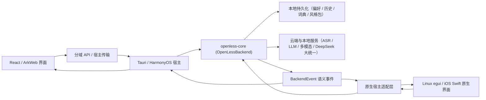

# OpenLess 架构、全平台形态与模块索引

OpenLess 采用 **界面层（UI）→ 平台宿主层（Host）→ 共享核心层（`openless-core`）** 三层架构：六个平台共享同一套框架无关的 Rust 核心库，各平台各自维护原生的窗口、快捷键、系统权限、输入法与凭据体验。

```text
React UI  ── Tauri 适配层（macOS / Windows / Android）──┐
egui UI   ── Linux 原生宿主（无 Tauri / WebKitGTK）─────┤
SwiftUI   ── iOS 原生应用与键盘（CoreHost）──────────────┼── openless-core
ArkTS UI  ── HarmonyOS 适配层（ArkWeb + napi）──────────┘
```

> 官网架构与数据流图览同步展示于 <https://openless.top/zh/docs/development/#架构>（English: <https://openless.top/en/docs/development/#architecture>）。本文中的源码路径均相对于仓库根目录，开发者全平台构建流程见 [中文全平台构建指南](../openless-all/README.zh.md)（[English](../openless-all/README.md)）。

## 全平台客户端形态、适配状态与子文档导航

| 平台 | 客户端形态与核心模块 | 当前状态与验收进度 | 分发方式 | 对应子文档 |
| --- | --- | --- | --- | --- |
| **macOS 14 Sonoma+** | Tauri 2 + React（[`src-tauri/`](../openless-all/app/src-tauri/)） | 完整桌面应用：全局快捷键、落字、连续听写、风格包、光标上下文、Apple Speech、实验性本地 ASR | DMG（Apple Silicon / Intel）、Homebrew cask | [全平台构建指南](../openless-all/README.zh.md) · [Homebrew 更新提醒](guides/homebrew.md) |
| **Windows 10+** | Tauri 2 + React（[`src-tauri/`](../openless-all/app/src-tauri/)）+ 原生 TSF 输入法（[`../windows/ime`](../openless-all/windows/ime/)） | 完整桌面应用，支持 TSF 输入法落字与 Foundry / sherpa 本地 ASR | NSIS / MSI 安装包 | [全平台构建指南](../openless-all/README.zh.md) |
| **Linux** | 原生 `egui` / `eframe` 宿主（[`../linux/egui`](../openless-all/linux/egui/)，无 Tauri / WebKitGTK）+ [`linux-fcitx5-plugin`](../openless-all/linux/fcitx5-plugin/) | 已接通 Core 2.0 服务与 `fcitx5` 插件；L01–L12 真机验收进行中，deb/rpm 自动化发布待恢复 | 源码构建 | [全平台构建指南](../openless-all/README.zh.md) · [命令事件兼容基线](linux-egui-command-event-baseline.json) |
| **Android 8.0+** | Tauri 移动宿主 + React + OpenLess 键盘（[`../android`](../openless-all/android/)、[`mobile-ime/`](../openless-all/app/mobile-ime/)） | 主应用、悬浮胶囊、输入法、光标上下文、应用内更新均已接通 | 按 ABI 提供 APK | [Android 说明](../openless-all/android/README.zh.md)（[EN](../openless-all/android/README.md)）· [Mobile IME](../openless-all/app/mobile-ime/README.zh.md)（[EN](../openless-all/app/mobile-ime/README.md)） |
| **iOS 16+** | 原生 SwiftUI/UIKit 主应用、键盘扩展与小组件（[`openless-all/ios/`](../openless-all/ios/)），`CoreHost` 桥接 Rust 核心 | 支持中英文输入、语音模式、长按空格听写、翻译与本地 SenseVoice | 源码构建 + 个人签名 | [iOS 构建与签名指南](../openless-all/ios/README.zh.md)（[EN](../openless-all/ios/README.md)） |
| **HarmonyOS** | ArkTS + ArkWeb + Node-API Core（[`../harmony`](../openless-all/harmony/)、[`mobile-ime/`](../openless-all/app/mobile-ime/)） | 适配中：已可构建 HAP 且输入法接入共享管线；真实联网真机验收、更新检测与商店分发待完成 | GitHub Releases 附未签名 HAP | [全平台构建指南](../openless-all/README.zh.md) · [Mobile IME](../openless-all/app/mobile-ime/README.zh.md) |

## 分层与核心模块职责

| 模块 | 源码入口与职责 |
| --- | --- |
| **共享核心（`openless-core`）** | [`crates/openless-core/`](../openless-all/app/crates/openless-core/)：框架无关的业务核心，不依赖 Tauri、WebView、egui 或 eframe。[`api.rs`](../openless-all/app/crates/openless-core/src/api.rs) 定义 `OpenLessBackend` 业务入口，[`ports.rs`](../openless-all/app/crates/openless-core/src/ports.rs) 定义录音、落字、凭据、存储等宿主端口，[`events.rs`](../openless-all/app/crates/openless-core/src/events.rs) 定义 `BackendEvent` 语义事件，[`dictation_engine.rs`](../openless-all/app/crates/openless-core/src/dictation_engine.rs) 协调单次与连续听写会话。 |
| **音频与原生胶囊 Crates** | [`crates/micyou-dsp`](../openless-all/app/crates/micyou-dsp/) 与 [`crates/micyou-infer`](../openless-all/app/crates/micyou-infer/) 提供降噪与回声消除前处理；[`crates/openless-capsule`](../openless-all/app/crates/openless-capsule/) 与 [`native-capsule`](../openless-all/app/native-capsule/) 提供原生语音胶囊状态与渲染支撑。 |
| **React 桌面/移动界面** | [`app/src/app`](../openless-all/app/src/app/) 负责启动与窗口路由，[`app/src/features`](../openless-all/app/src/features/) 承载设置、历史、风格包、词典、云同步等业务页面，[`app/src/data`](../openless-all/app/src/data/) 管理快照缓存与失效，[`app/src/api`](../openless-all/app/src/api/) 提供分域调用，[`app/src/runtime/transport.ts`](../openless-all/app/src/runtime/transport.ts) 校验契约版本并封装 IPC；[`app/src/preview`](../openless-all/app/src/preview/) 提供浏览器预览夹具。 |
| **桌面问答与选区改写** | [`app/ask-window`](../openless-all/app/ask-window/) 承载独立问答与选区改写窗口，与宿主原生通道协同调用 `openless-core` 的问答、选区处理、联网搜索与附件能力。 |
| **Tauri 宿主（macOS / Windows / Android）** | [`src-tauri/src/lib.rs`](../openless-all/app/src-tauri/src/lib.rs) 注册 IPC 命令与窗口生命周期，[`coordinator.rs`](../openless-all/app/src-tauri/src/coordinator.rs) 管理快捷键与会话所有权，[`core_adapters.rs`](../openless-all/app/src-tauri/src/core_adapters.rs) 对接录音、剪贴板/辅助功能/TSF 落字与系统凭据库，[`tauri_events.rs`](../openless-all/app/src-tauri/src/tauri_events.rs) 转发语义事件与胶囊状态。 |
| **Linux 原生宿主（egui）** | [`linux/egui`](../openless-all/linux/egui/) 常驻宿主直接调用 `openless_core::contract`，与界面子进程经 Unix Socket（JSONL v2）同步快照与事件，经 [`linux-fcitx5-plugin`](../openless-all/linux/fcitx5-plugin/) 完成输入法落字。 |
| **移动端输入法与原生宿主** | Android（[`android`](../openless-all/android/)）与 HarmonyOS（[`harmony`](../openless-all/harmony/)）共享 [`app/mobile-ime`](../openless-all/app/mobile-ime/) 输入法核心；iOS（[`openless-all/ios`](../openless-all/ios/)）由主应用承载麦克风录音与 Keychain 凭据，键盘扩展与主应用经 App Group 交换有限指令与结果（不经 App Group 传递原始音频）。 |
| **跨层契约定义** | [`app/contract/backend-2.0.json`](../openless-all/app/contract/backend-2.0.json) 固定启动快照、语义事件、枚举与宿主门面契约（版本 `2.0.0`）。修改跨层命令或事件时须同步检查 Rust、TypeScript、宿主注册端及兼容基线 [`linux-egui-command-event-baseline.json`](linux-egui-command-event-baseline.json)。 |

## 请求与事件流向



## 核心数据流与安全边界

### 1. 启动、配置与持久化

1. 界面启动时拉取一份 `BootstrapSnapshot`（含当前版本、偏好设置、服务商、风格包与运行状态），随后仅通过增量语义事件同步变更，避免整页重刷。
2. 宿主在启动阶段注册快捷键、系统托盘与原生胶囊，并按平台检查系统权限（如 macOS 麦克风与辅助功能、Windows 麦克风与全局热键监听）。
3. 设置更新以字段补丁方式提交（`update_setting_fields`），Core 按修订号串行持久化并广播 `prefs:changed`；写入失败时仅回退未确认的局部编辑。
4. 历史记录、活动热力图统计与服务用量台账分表存储，各自执行独立的保留与清理策略。

### 2. 语音听写、后处理与光标回填

单次及连续语音输入的完整链路：

`全局快捷键 / 触发按钮 → Coordinator（会话所有权） → 麦克风 PCM 采集 → openless-core 听写引擎 → 识别与后处理管线 → 宿主安全落字 / 剪贴板回退 → 历史与统计持久化`

- **三条语音与模型管线**（配置指南见 <https://openless.top/zh/docs/setup/> 与 [仓库入口说明](guides/speech-services.md)）：
  - **传统模式（ASR + 可选 LLM）**：支持近 30 个云端与本地 ASR 渠道（火山引擎、阿里云百炼、讯飞 RTASR、腾讯混元、阶跃星辰、智谱 GLM、小米 MiMo、Whisper 兼容、Apple Speech 及 Foundry/sherpa/MLX 本地模型），自由搭配 20+ 润色模型（火山方舟、DeepSeek、OpenAI、Gemini、OpenRouter 及任意 OpenAI 兼容端点）。
  - **多模态模式（单模型）**：由 Google Gemini、OpenAI Audio、阿里云 Qwen-Omni 等支持音频输入的模型一步完成转写与润色。
  - **DeepSeek 大统一**：使用 DeepSeek 官方密钥统一承接语音听写、问答、原生联网搜索与回答朗读。
- **连续输入与后台队列**：支持连续多段（10～20 段）语音输入。前一段录音停止后立刻进入后台异步队列（冻结原 `sessionId`、目标应用与光标上下文），用户可直接开始下一段，最终结果按提交顺序依次写回原输入框。单段取消、超时或失败仅清理当前片段。
- **风格包、词典与光标上下文**：识别前台应用或应用分类后自动匹配对应风格包；个人词典按命中优先级注入 ASR 热词与润色提示词；可选的「从纠正中学习」需逐条确认且仅保存在本地；可选光标上下文自动排除密码框、安全输入与终端。
- **落字与回退**：优先经原生辅助功能、输入法插件（Fcitx5 / 移动端 IME / Windows TSF）或系统插入通道直写目标框；遇到受限窗口时自动回退到剪贴板。

### 3. 远程输入、加密云同步与凭据管理

- **手机远程输入**：桌面端启动局域网 HTTPS 服务并生成本机根证书与配对码；手机浏览器核对证书 SHA-256 指纹并配对后上传语音，由桌面端完成转写、润色并写入电脑光标处（使用方式见 [手机远程输入指南](guides/remote-input.md)）。
- **加密云同步**：同步偏好、词典、风格包与历史前在客户端完成端到端加密（`cloud_sync_e2ee`），服务端仅存储密文快照。
- **服务密钥与凭据**：所有第三方服务 API Key 由操作系统凭据库保存（macOS Keychain / Windows Credential Manager / Linux Secret Service / iOS Keychain），不以明文形式写入配置或提交到仓库。

## 客户端架构与流程图

可编辑 Mermaid 源文件（`.mmd`）与导出图片（`.svg` / `.png`）统一存放在 [`docs/images/client-diagrams/`](images/client-diagrams/README.md)：

### 客户端架构


[中文 SVG](images/client-diagrams/openless-client-architecture.zh-CN.svg) · [中文 Mermaid](images/client-diagrams/openless-client-architecture.zh-CN.mmd) · [English PNG](images/client-diagrams/openless-client-architecture.png) · [English SVG](images/client-diagrams/openless-client-architecture.svg)

### 客户端数据流


[中文 SVG](images/client-diagrams/openless-client-data-flow.zh-CN.svg) · [中文 Mermaid](images/client-diagrams/openless-client-data-flow.zh-CN.mmd) · [English PNG](images/client-diagrams/openless-client-data-flow.png) · [English SVG](images/client-diagrams/openless-client-data-flow.svg)

### 启动、权限与录音流程


[中文 SVG](images/client-diagrams/openless-client-startup-recording-flow.zh-CN.svg) · [中文 Mermaid](images/client-diagrams/openless-client-startup-recording-flow.zh-CN.mmd) · [English PNG](images/client-diagrams/openless-client-startup-recording-flow.png) · [English SVG](images/client-diagrams/openless-client-startup-recording-flow.svg)

## 分支、发布机制与平台工程规划

- **双渠道分支**：`beta` 为默认开发集成分支（Beta 渠道），`main` 为正式版分支（仅由维护者从 `beta` 合并）；所有贡献 PR 统一提交至 `beta`。
- **更新器清单**：桌面端更新器清单托管在 `https://dl.aeoform.com/updates/{stable|beta}/latest-{target}-{arch}[-beta].json`，不附在 GitHub Release 资产中。
- **维护者发布清单**：[RELEASING.zh.md](../RELEASING.zh.md)（[English](../RELEASING.md)）记录发布权限、五处版本号同步闸门、签名公证、HarmonyOS 渠道与发布说明署名规范。
- **阶段重点与平台验收**：
  - 当前阶段优先保障核心听写链路稳定（录音、转写、历史恢复、可靠落字、兼容性、测试与文档），详见 [维护公告 #1479](https://github.com/Open-Less/openless/issues/1479)。
  - **Linux**：完成 L01–L12 真机验收并恢复 deb/rpm 自动发布流水线。
  - **HarmonyOS**：完成真实联网真机验收、应用内更新检测与商店分发。
