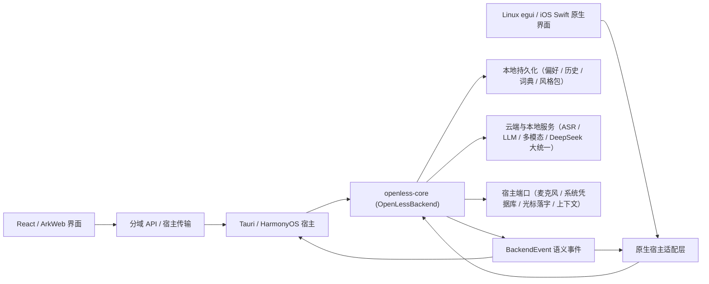
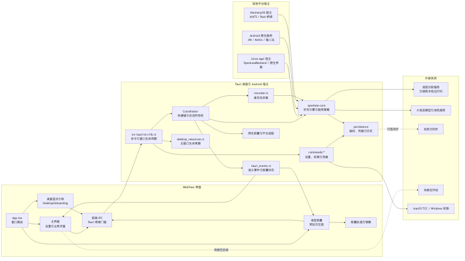
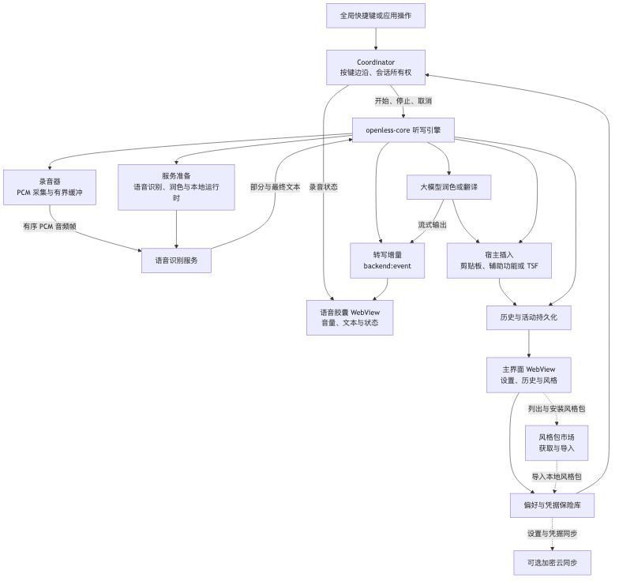
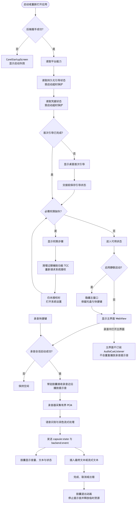

# OpenLess 架构与模块说明

OpenLess 采用 **界面层（UI）→ 平台宿主层（Host）→ 共享核心层（`openless-core`）** 三层分层架构：各平台保留原生窗口、快捷键、权限、输入法与凭据体验，核心听写流水线、识别/润色策略、词典、风格包与持久化规则统一沉淀在框架无关的 Rust 核心库中。

> 官方架构与数据流图览同步展示于 <https://openless.top/zh/docs/development/#架构>（English: <https://openless.top/en/docs/development/#architecture>）。本文中的源码路径均相对于仓库根目录。

## 分层与模块职责

| 模块 | 职责与主要源码入口 |
| --- | --- |
| **共享核心（`openless-core`）** | 框架无关的业务核心，不依赖 Tauri、WebView、egui 或 eframe。[`api.rs`](../openless-all/app/crates/openless-core/src/api.rs) 定义 `OpenLessBackend` 业务入口，[`ports.rs`](../openless-all/app/crates/openless-core/src/ports.rs) 定义录音、落字、凭据、存储等宿主端口，[`events.rs`](../openless-all/app/crates/openless-core/src/events.rs) 定义 `BackendEvent` 语义事件，[`dictation_engine.rs`](../openless-all/app/crates/openless-core/src/dictation_engine.rs) 协调单次与连续听写会话。 |
| **音频与辅助 Crates** | [`crates/micyou-dsp`](../openless-all/app/crates/micyou-dsp/) 与 [`crates/micyou-infer`](../openless-all/app/crates/micyou-infer/) 提供音频降噪/回声消除前处理与推理支持；[`crates/openless-capsule`](../openless-all/app/crates/openless-capsule/) 与 [`native-capsule`](../openless-all/app/native-capsule/) 提供原生语音胶囊状态与渲染支撑。 |
| **React 桌面/移动界面** | [`app/src/app`](../openless-all/app/src/app/) 负责启动与窗口路由，[`app/src/features`](../openless-all/app/src/features/) 承载设置、历史、风格包、词典、云同步等业务页面，[`app/src/data`](../openless-all/app/src/data/) 管理快照缓存与失效，[`app/src/api`](../openless-all/app/src/api/) 提供分域调用，[`app/src/runtime/transport.ts`](../openless-all/app/src/runtime/transport.ts) 校验契约版本并封装 IPC；[`app/src/preview`](../openless-all/app/src/preview/) 提供浏览器预览夹具。 |
| **macOS / Windows / Android 宿主（Tauri）** | [`src-tauri/src/lib.rs`](../openless-all/app/src-tauri/src/lib.rs) 注册 IPC 命令与窗口生命周期，[`coordinator.rs`](../openless-all/app/src-tauri/src/coordinator.rs) 管理快捷键与会话所有权，[`core_adapters.rs`](../openless-all/app/src-tauri/src/core_adapters.rs) 对接录音、剪贴板/辅助功能/TSF 落字与凭据库，[`tauri_events.rs`](../openless-all/app/src-tauri/src/tauri_events.rs) 转发语义事件与胶囊状态。Android 平台扩展与输入法桥接见 [`app/android`](../openless-all/app/android/) 与 [`app/mobile-ime`](../openless-all/app/mobile-ime/)。 |
| **Linux 原生宿主（egui）** | [`app/linux-egui`](../openless-all/app/linux-egui/) 使用 `egui` / `eframe` 界面与常驻宿主，不依赖 Tauri 或 WebKitGTK。宿主进程内直接调用 `openless_core::contract`，并与界面子进程经 Unix Socket（JSONL v2）同步快照和事件，经 [`linux-fcitx5-plugin`](../openless-all/app/scripts/linux-fcitx5-plugin/) 完成输入法落字。详见 [Linux 宿主与 egui 接口说明](development/linux.md)。 |
| **HarmonyOS 宿主** | [`app/harmony`](../openless-all/app/harmony/) 由 ArkTS 管理系统与输入法，ArkWeb 复用前端界面，`harmony/rust` 经 Node-API 接入 `openless-core`，共享 [`app/mobile-ime`](../openless-all/app/mobile-ime/) 输入法核心。 |
| **iOS 原生应用与键盘** | [`openless-all/ios`](../openless-all/ios/) 包含 Swift 主应用、自定义中文/英文键盘扩展与录制小组件。`CoreHost` 提供原生 Rust 桥，主应用负责麦克风录音与 Keychain 凭据，扩展通过 App Group 交换有限指令与结果（不经 App Group 传递原始音频）。 |
| **跨层契约定义** | [`app/contract/backend-2.0.json`](../openless-all/app/contract/backend-2.0.json) 固定启动快照、语义事件、枚举与宿主门面契约（版本 `2.0.0`）。修改跨层命令或事件时须同步检查 Rust、TypeScript、宿主注册端及兼容基线 [`linux-egui-command-event-baseline.json`](linux-egui-command-event-baseline.json)。 |

## 请求与事件流向

## 核心数据流

### 1. 启动、权限与配置写入

1. 界面入口等待宿主就绪并请求 `get_startup_snapshot`，验证后端契约版本与平台能力后再挂载业务界面。
2. 首次运行进入引导并检查系统权限（如 macOS 麦克风/辅助功能、Windows 麦克风与全局热键监听）。
3. 设置更新以字段补丁方式提交（`update_setting_fields`），Core 按修订号串行持久化并广播 `prefs:changed`；写入失败时仅回退未确认的局部编辑。
4. 历史记录、活动热力图统计与服务用量台账分表存储，各自遵守独立的保留与清理策略。

### 2. 语音听写、后处理与光标回填

单次及连续语音输入的完整数据流与官网文档保持一致：

`全局快捷键 / 触发按钮 → Coordinator（会话所有权） → 麦克风 PCM 采集 → openless-core 听写引擎 → 识别与后处理管线 → 宿主安全落字 / 剪贴板回退 → 历史与统计持久化`

- **三条识别与后处理管线**（详细配置见 <https://openless.top/zh/docs/setup/>）：
  - **传统模式**：由 ASR 渠道（火山引擎、阿里云百炼、讯飞 RTASR、腾讯混元、Google Gemini Transcribe 或本地模型）生成转写原文，再由可选 LLM 渠道按风格包执行去口癖、口述改口修正、Prompt 结构化整理或实时翻译。
  - **多模态模式**：由单个支持音频输入的模型（如 Google Gemini、OpenAI Audio、阿里云 Qwen-Omni）直接完成音频理解与文字输出。
  - **DeepSeek 大统一**：使用 DeepSeek 官方密钥统一承接录音后语音识别、问答、原生联网搜索与回答朗读。
- **连续输入与后台异步处理**：支持连续多段（10～20 段）语音输入。前一段录音停止后即转入后台异步处理队列（冻结原 `sessionId`、目标应用与上下文），用户可立即开始下一段录音；最终结果按提交顺序依次写回原应用和光标位置。单段取消、超时或错误仅清理本段资源，不影响后续会话。
- **按应用自动切换风格包与个人词典**：识别当前前台应用或应用分类后自动匹配对应风格包（聊天、邮件、笔记、编程、Prompt 等）；结合个人词典与（可选开启的）光标上下文改善人名、术语与同音词准确率。
- **落字与安全回退**：优先通过原生辅助功能、输入法插件（Fcitx5 / 移动端 IME / Windows TSF）或系统插入通道写入目标输入框；遇到受限窗口无法直写时自动回退至剪贴板，确保文本不丢失。

### 3. 问答与选区改写

桌面端独立问答与选区改写通过 [`ask-window`](../openless-all/app/ask-window/) 与宿主原生通道协同工作，调用 `openless-core` 的问答、选区处理、联网搜索与附件能力，并遵循明确的写回保护规则。

### 4. 远程输入与加密云同步

- **手机远程输入**：桌面端开启局域网 HTTPS 服务并生成本机根证书与配对码；手机浏览器在核对证书 SHA-256 指纹并配对后上传语音，由桌面端完成转写、润色并写入电脑光标位置（使用方式见 [手机远程输入指南](guides/remote-input.md)）。
- **加密云同步**：同步偏好、词典、风格包等本地数据前在客户端完成端到端加密（`cloud_sync_e2ee`），服务端仅存储密文快照。
- **服务密钥与凭据**：所有第三方云服务 API Key 交由操作系统凭据库保存（macOS Keychain / Windows Credential Manager / Linux Secret Service / iOS Keychain），不以明文形式写入源码或提交至仓库。

## 客户端架构与数据流图

以下图表源文件与渲染结果位于 [`docs/images/client-diagrams/`](images/client-diagrams/README.md)（含英文与中文 `.mmd` / `.svg` / `.png`）：

### 客户端架构

[中文 SVG](images/client-diagrams/openless-client-architecture.zh-CN.svg) · [中文 Mermaid](images/client-diagrams/openless-client-architecture.zh-CN.mmd) · [English PNG](images/client-diagrams/openless-client-architecture.png) · [English SVG](images/client-diagrams/openless-client-architecture.svg)

### 客户端数据流

[中文 SVG](images/client-diagrams/openless-client-data-flow.zh-CN.svg) · [中文 Mermaid](images/client-diagrams/openless-client-data-flow.zh-CN.mmd) · [English PNG](images/client-diagrams/openless-client-data-flow.png) · [English SVG](images/client-diagrams/openless-client-data-flow.svg)

### 启动、权限与录音流程

[中文 SVG](images/client-diagrams/openless-client-startup-recording-flow.zh-CN.svg) · [中文 Mermaid](images/client-diagrams/openless-client-startup-recording-flow.zh-CN.mmd) · [English PNG](images/client-diagrams/openless-client-startup-recording-flow.png) · [English SVG](images/client-diagrams/openless-client-startup-recording-flow.svg)
