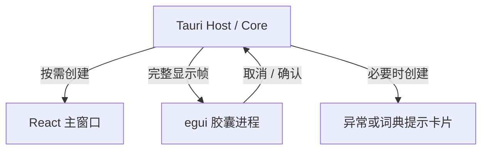

# 桌面低内存后台模式与 egui 胶囊设计

关联 Issue：[Open-Less/openless#1174](https://github.com/Open-Less/openless/issues/1174)。
基线：`beta` 分支 `1ff361a89c896ae07d22d597df3f5dc69cd79b5d`。

本文描述为后续 PR 准备的实现分支的资源边界、实现决策、故障处理和验证方法。
当前交付流程为先上传个人 fork，完成本地测试后再决定是否向上游提交 PR。
涉及桌面窗口、
系统音频和进程内存的结论必须通过 Windows/macOS 真机实验确认，编译通过不代表这些行为已验证。

## 1. 目标和范围

OpenLess 需要长期监听快捷键，但听写通常短暂、间歇发生。本次优化的目标是降低
正常空闲时的常驻开销：允许录音、识别和界面显示期间临时增加内存，任务完成后释放临时界面资源。

本 PR 包含：

- 可选的桌面低内存后台模式，默认关闭，修改后重启生效。
- 主窗口在需要显示时创建，关闭时销毁 WebView；托盘、快捷键和 Core 继续运行。
- 将 Linux 已有的 egui 胶囊绘制代码提取为共享模块，桌面端按需启动独立胶囊进程。
- 胶囊结束后终止并回收其进程，使字体、纹理、图形上下文随进程释放。
- 原生开始录音提示音、实时转写显示、会话操作和必要的异常提示适配。
- 低内存模式下暂停麦克风常驻预热，关闭设置时清理麦克风测试流。

**本地模型的加载、保留时间、空闲卸载和缓存实现沿用项目原有机制。本 PR 不增加、
删除或改变模型卸载选项，也不把关闭浮窗等同于卸载模型。**

本次不重写完整 React 主界面，不替换 ASR/LLM，不改变历史、词典、插入逻辑和模型凭据。
QA、Less Computer 等非听写窗口继续使用现有生命周期；曾打开这些窗口后，其隐藏
WebView 仍可能存在。因此，本 PR 的“无常驻主窗口和录音胶囊 WebView”不能表述为
“整个应用在所有使用路径下绝无 WebView”。其他辅助窗口的空闲释放是后续独立工作。

## 2. 原有实现与复用边界

原有桌面 `lib.rs` 在主窗口 `CloseRequested` 时调用 `prevent_close()` 和 `hide()`。
`main`、`capsule` 以及 Windows 的 `capsule-rail` 由配置预创建。隐藏窗口不能作为
网页运行环境已释放的证据。

Linux 的 egui Host 已有录音胶囊，包含 Siri、Classic、Typeless 样式、音量反馈、
取消和确认操作。其主机适配依赖 X11、Wayland、fcitx5，不能直接作为桌面端依赖。

此次提取的范围是纯绘制和轻量状态 DTO：

| 模块 | 职责 | 依赖边界 |
| --- | --- | --- |
| `crates/openless-capsule` 默认功能 | 消息、帧、版本及会话校验 | serde，Rust 1.88，不依赖 Tauri/egui |
| `openless-capsule/host` | 非阻塞进程监管、有限队列、管道读写 | Tokio，不依赖图形库 |
| `openless-capsule/ui` | 原有胶囊与 Siri 视觉绘制 | egui/resvg，与 Linux 共用 |
| `native-capsule` | 独立窗口、字体、原生行为 | eframe，Rust 1.95+ |
| `src-tauri/src/native_capsule.rs` | 从现有反馈快照生成显示帧，接收操作 | Tauri Host 适配 |
| `src-tauri/src/desktop_resources.rs` | 主窗口创建、销毁及资源策略 | 桌面生命周期 |

Linux 保留其主机和协议，通过薄包装调用共享绘制函数，继续使用原有语言目录。
没有将整个 Linux UI 或平台依赖搬入 Windows/macOS Host。

## 3. 进程和状态所有权



Core 是语音会话、识别、润色和插入状态的唯一所有者。胶囊进程没有麦克风、
快捷键、凭据、模型或业务状态；它只绘制收到的快照，并报告用户操作。

启动胶囊不属于开始录音的前置条件。现有反馈入口在提交会话快照后将显示帧交给
进程监管器；监管器在异步任务中启动子进程、等待握手及写管道。音频回调不等待
进程启动、字体加载或图形初始化。

| 场景 | 主窗口 | 录音胶囊 | 后台 |
| --- | --- | --- | --- |
| 静默启动并空闲 | 未创建 | 无子进程 | Core、快捷键、托盘 |
| 打开设置 | 按需创建 | 按会话需要 | 继续运行 |
| 关闭设置 | 保存当前正常尺寸后销毁 | 按会话需要 | 继续运行 |
| 听写处理中 | 不要求存在 | 创建并显示 | 录音/ASR/LLM/插入 |
| 完成提示结束，收到 Idle | 不要求存在 | 退出并等待回收 | 返回后台状态 |
| 插入失败或词典提示 | 不要求存在 | 让出显示 | 仅创建提示卡片 WebView |

## 4. 开关和兼容性

新增 `lowMemoryBackgroundEnabled`，旧配置缺失时默认为 `false`。字段属于设备配置，
不是模型参数。主窗口设置页显示"重启后生效"，并解释麦克风预热和本地模型策略。
开关与当前运行模式不一致时，设置页额外显示重启提示行和一键重启按钮（复用既有
`restart_app` 命令；该命令跳转到主线程执行重启，避免低内存模式的
`ExitRequested { code: None }` 拦截把重启吞掉）。胶囊辅助程序初始化失败时，
设置页通过 `native_capsule_status` 显示健康告警，而不是静默降级。

Host 在启动时读取一次该开关，将 `main/capsule/capsule-rail` 配置的自动创建标记关闭。
运行中不切换胶囊所有权，避免已开始的语音会话在两套界面之间迁移。

关闭模式后重启，恢复原有窗口保留方式。Android/iOS 的主窗口和移动端命令路径
不使用桌面资源策略。

主窗口从原有平台窗口配置重建，继续使用相同标签、前端入口、权限和平台样式。
每次创建都应用 macOS 磨砂和 Windows Mica。当前进程内保存正常尺寸、位置及最大化
状态；不承诺保存未提交的表单草稿或临时导航状态。持久化设置仍由原有存储负责。

## 5. 窗口关闭、重建与退出

关闭主窗口时进入 `closing` 状态，避免同名窗口尚未移除时重复创建。销毁期间
收到再次打开请求时记录 `reopen_pending`，在 `Destroyed` 之后重建。低内存模式下
关闭主窗口改为"先隐藏、3 秒宽限期后销毁"：宽限期内重新打开会取消销毁并直接
恢复原窗口，避免误关导致未提交的表单草稿丢失；宽限期计时使用代次令牌防止
二次关闭重置期限后被旧计时器提前销毁。

主窗口销毁产生的自动退出请求通过 `ExitRequested { code: None }` 拦截。
托盘退出及显式重启带退出代码，仍沿用原有退出逻辑。退出时停止胶囊和提示音。

关闭设置还需要释放麦克风电平测试流。清理在阻塞工作任务中完成，避免音频线程
停止等待阻塞桌面主线程；预热选项在低内存模式下被资源策略抑制，用户原有选择
不会被改写。

必须实测的竞态包括：关闭后立即点击托盘、多次点击打开、录音中打开/关闭设置、
显式退出和重启。不能把仅能成功调用 `destroy()` 视为生命周期改造完成。

## 6. 胶囊通信和监管

通信使用继承的 stdin/stdout JSONL 管道，不开放网络端口。stderr 仅用于诊断。

- 首先等待 `Ready`，校验协议版本，然后发送最新完整帧。
- 显示帧包含会话 ID、显示序号、状态、样式、音量、转写文字、语言和目标屏幕位置。
- 音量和文字更新用 `watch` 合并，只保留最新帧；UI 接收队列也有固定容量。
- 单条 JSONL 上限为 1 MiB，读取时也限制分配，避免损坏的消息触发无界分配。
- 写管道和初始化握手设有超时；挂起的渲染进程不能拖住语音管线。
- Idle 结束当前子进程；先等待正常退出，超时后终止并回收，再允许创建下一实例。
- 父管道 EOF 会使浮窗主动关闭；Host 侧同时使用 `kill_on_drop`。
- 启动失败只作有限重试，同一会话连续失败后不因每个音量帧反复启动进程。

取消/确认事件携带其绘制帧的会话 ID 和序号。Host 先校验显示帧，再在异步操作
开始前确认 Core 当前会话。允许同一会话稍旧的音量帧按钮操作，拒绝未来序号、
其他会话和已结束状态。确认操作仅适用于仍在录音的听写。

非听写功能的胶囊继续作为显示器，其操作由已有 QA/Agent 窗口管理，不能让一个
迟到的辅助窗口按钮取消另一个业务域的新会话。

## 7. 原生平台适配

### Windows

辅助进程以无控制台方式启动。窗口使用无装饰、置顶、隐藏任务栏和非激活样式。
位置由 Host 现有 `foreground_window_monitor()` 选择当前输入应用所在屏幕，
使用物理坐标传递，避免主副屏缩放不同造成的偏移。

Siri 样式为鼠标穿透；Classic/Typeless 保留取消和确认。必须验证按钮点击不改变
输入焦点，以及透明区域不会遮挡底层应用。

### macOS

辅助程序的独立 Info.plist 以 `LSUIElement = true` 嵌入执行文件，启动前即声明
无 Dock 图标的 agent 身份，入口及事件循环均使用 Accessory 激活策略。
胶囊配置为非激活 NSPanel，设置
`CanJoinAllSpaces` 和 `FullScreenAuxiliary`，显示和点击时不能把用户切回 OpenLess。
AppKit 操作只发生在辅助进程主线程。

当前 eframe/winit 没有直接创建 NSPanel 的公开入口，因此适配在 NSWindow
初始化和 KVO 注册之前转换无实例变量的 WinitWindow，并调用真正的 NSPanel
初始化函数；收到 CreationContext 后立即恢复原始初始化实现。检查原分配
大小等于 NSWindow、且足以容纳 NSPanel，避免换类破坏已安装的观察者。
此部分依赖固定 `winit 0.30.13` 和 SDK 行为，是需要维护者重点评审并真机验证
的边界；尺寸检查不等于完整兼容性证明。升级后必须重新检查。修复设计及
启动/退出回归见 [macos-native-capsule-fixes.md](macos-native-capsule-fixes.md)。

不能凭 `always_on_top` 或交叉编译通过就声称全屏 Space 支持已验证。

## 8. 提示音、文字及提示卡片

原来提示音由 Web Audio 播放。没有常驻 WebView 后，Host 用 CPAL 播放相同的
880 Hz/1108.73 Hz 开始提示音，短时输出流随工作线程结束而释放。WebView 根据
实际运行模式关闭自身提示音监听，避免主设置窗口打开时重复响铃。

实时文字来自现有胶囊快照，绘制在原生胶囊上方。终态清除文字，下一会话不能
重放前一会话的转写。系统 CJK 字体仅加载到一次性的 UI 进程。

词典学习和插入失败卡片继续使用原有 React UI，但只在有可见内容时创建 WebView。
前端安装监听后读取一次提示快照，补偿冷启动前已发送的第一条事件；卡片收起时
销毁窗口。macOS 的临时卡片不进入 tauri-nspanel 的长期引用注册表，以免销毁窗口
后仍被注册表保留。

这些卡片属于需要用户处理的可见状态。卡片还在屏幕上时，不能把应用当作完全
空闲并为节省内存自动丢弃未插入的文字。

## 9. 打包与工具链

`npm run build:native-capsule` 构建原生辅助程序并准备 Tauri `externalBin` 文件。
macOS/Windows 的平台配置在打包前运行该命令，开发模式使用 debug 构建。
Android 不运行该构建步骤。

辅助程序需要 Rust 1.95+，与原有 Linux egui 路线一致。Tauri Host 只依赖共享
协议和监管功能，保持 Rust 1.88 的依赖边界。应检查 Host 的依赖树没有 egui、
eframe、winit 或新增图形驱动依赖。

macOS 发布仍需验证辅助可执行文件的签名、架构、安装路径和首次运行。
Windows 发布需验证 NSIS/MSI 安装后能找到辅助程序，且不会出现控制台闪烁。
新增独立 CI 检查辅助程序的 macOS/Windows 编译和共享模块测试。

## 10. 验证与内存实验

自动检查与设备证据分开记录。自动检查包括共享模块协议与绘制测试、Core 测试、
Linux 共享模块回归、前端 TypeScript/Vite、桌面辅助程序跨目标检查，以及现有
桌面窗口契约。完整桌面 Host 编译和运行仍依赖对应平台工具链。

内存实验按相同版本、配置、ASR provider 和系统进行，对比普通模式和低内存模式：

1. 使用云端 ASR，以隔离本地模型保留时间；静默启动后等待 5 分钟。
2. 记录主进程和全部 WebView/胶囊子进程的内存，不能只看 Tauri 主进程。
3. 打开设置、关闭设置，再等待 5 分钟；记录窗口与子进程是否实际消失。
4. 连续听写 30–50 次，包含取消、网络失败和插入失败；每次回到 Idle 后采样。
5. 使用本地模型重复实验，保留项目原有卸载配置，并把模型内存另列。
6. 同时记录快捷键到开麦、快捷键到浮窗首帧、识别完成到 Idle 的时间。

Windows 记录 Private Bytes/Working Set 与 WebView2 全部进程；macOS 记录
phys_footprint 和相关 WebKit/辅助进程。系统缓存和分配器行为可能使主进程 RSS
不完全返回初始数值，不能据此直接断定模型泄漏或资源未释放。

| 设备场景 | 预期 | 必须取得的证据 |
| --- | --- | --- |
| 静默启动 | 无主/录音 WebView，无胶囊进程 | 进程列表与内存采样 |
| 快捷键听写 | 录音不等待 UI | 时间戳及语音开头完整性 |
| 设置关闭、立即重开 | 只有一个主窗口，后台不退出 | 操作录像/日志 |
| 完成/取消/错误 | 胶囊自动结束，无残留进程 | 进程退出及会话日志 |
| macOS 全屏与多个 Space | 原生胶囊出现，不切换焦点 | 真机录像 |
| Windows 多屏不同 DPI | 位置正确、按钮不抢焦点 | 真机截图/录像 |
| 插入失败 | 完整文字与复制按钮保留 | 失败场景复现 |
| 系统退出/父进程异常结束 | 无孤儿胶囊 | 进程与退出日志 |
| 普通模式回归 | 原有体验保持 | 对照运行 |

当前分支先用于个人 fork 的本地测试，不直接创建 PR。完整 Host 检查、安装包测试
和上述设备项完成后，再整理实际测试证据并向上游提交。
不预先承诺节省多少 MB，也不把“换成 Rust UI”本身视为性能结果。

## 11. 后续边界

其他辅助 WebView、临时窗口透明点击区域、全屏 Space 和连续快速听写是后续
验证重点。若维护者希望缩小首次合并范围，可以保留主窗口资源策略和共享绘制
提取，将桌面原生胶囊适配单独提交；两者的 Core 接口不互相依赖。

本地 Whisper 的内存增长 Issue #1166 应继续单独定位。本次界面资源释放不能
作为该模型问题已经修复的证据。

## 12. 分支验证记录与本地复现

验证日期：2026-10-12。执行环境为 Linux 构建容器，基于本文所列 beta 基线。

| 检查 | 结果 | 证据边界 |
| --- | --- | --- |
| Core library 单元测试 | 1145 通过，1 忽略 | 包括配置向后兼容；没有更改模型卸载实现 |
| 共享胶囊 ui/host 测试 | 7 通过 | 消息大小、会话校验、绘制、握手取消、Idle 回收及新会话重放 |
| Linux 原有胶囊测试 | 6 通过 | 确认绘制提取后的样式及按钮回归 |
| Linux Host check/clippy | 通过 | 对全部目标检查，clippy 使用 `-D warnings` |
| 原生胶囊 check/clippy | 通过 | Linux 检查及 Windows GNU/macOS ARM 交叉目标检查 |
| TypeScript/Vite 生产构建 | 通过 | 包含新的设置、语言同步和提示卡片快照读取 |
| 前端 TypeScript 测试 | 54 个测试文件通过 | 使用 Node 的 tsx loader 执行，避开容器禁止 Unix socket 的 CLI 行为 |
| 新增 Host 适配文件独立 Windows 类型检查 | 通过 | 使用真实 Tauri/Core/CPAL，既有 Coordinator 入口用 stub；不等同于完整 Host 编译 |
| 完整 Windows Host 检查 | 未完成 | 既有 Foundry SDK 构建需下载 NuGet/微软原生依赖，容器连接被拒绝 |
| macOS/Windows 真机及安装包 | macOS 基础启动/退出及后台快照已补；其余待验证 | macOS Space/点击焦点、多屏、Windows 真机及正式发行签名/公证仍缺证据 |

现有前端 JavaScript 契约测试已执行至 TypeScript 阶段，没有观察到断言失败。
原始完整测试入口最终受 tsx CLI 的 Unix socket 权限限制退出，因此不记录为
“完整前端测试入口通过”；TypeScript 文件另行执行，得到上表结果。

在 macOS 或 Windows 的项目目录中，先初始化原有原生子模块并安装依赖：

```sh
git submodule update --init --recursive
cd openless-all/app
npm ci
cargo test --locked -p openless-capsule --features ui,host
cargo check --locked -p openless-native-capsule
cargo clippy --locked -p openless-native-capsule -p openless-capsule --features openless-capsule/ui,openless-capsule/host -- -D warnings
npm run build
npm run tauri dev
```

平台 Tauri 配置的 `beforeDevCommand` 会先构建 debug 辅助程序，打包则构建 release
辅助程序。原生辅助程序需 Rust 1.95+。首次构建仍需原有 Host 的平台 SDK、Foundry
和模型依赖；这些依赖未被本分支替换。安装包可通过 `npm run tauri build` 生成。

第一次启动时启用“低内存后台模式”，并选择原有“启动后最小化”，重启后进行
静默启动实验。若没有选择启动后最小化，低内存模式仍尊重原有显示主窗口的启动
偏好；主窗口关闭之后才进入后台资源状态。使用托盘打开/关闭设置，确认窗口关闭
后仍能完整听写，再按第 10 节逐项记录设备结果。

### macOS 真机内存实测（2026-10-12，Apple Silicon，phys_footprint）

同一台机器使用云端 ASR 的历史快照与修复后后台复核如下。各次窗口状态不同，
这些记录不能替代相同窗口状态、相同编译配置下的 A/B 实验：

| 实际采样状态 | 总 phys_footprint | 证据边界 |
| --- | --- | --- |
| 普通模式，主窗口和识别状态开启 | ≈310 MB | 未测普通模式所有窗口关闭后的同状态对照 |
| 低内存模式，冷启动静默 | ≈45 MB | 仅主进程 |
| 低内存模式，听写胶囊开启 | ≈255 MB | 原生胶囊约 192 MB，为临时占用 |
| 低内存模式，会话后所有窗口关闭 | ≈60 MB | 主进程约 55 MB，加 Networking 约 5 MB |
| 含 macOS 胶囊修复的本地构建，所有窗口关闭 | **≈54 MB** | 主进程 48 MB，保守计入唯一 Networking 5.6 MB；无 WebContent/GPU/胶囊进程 |

进程构成：普通模式主窗口和识别状态开启时，4 个 WebKit XPC 服务共约 263 MB，
主进程约 47 MB；低内存模式空闲时仅主进程
（约 40–55 MB）外加一个约 5 MB 的 `com.apple.WebKit.Networking` 共享服务残留。
胶囊进程听写期间约 192 MB，其中约 53 MB 为整体读入的 CJK 系统字体文件
（PingFang 缺失时回退 STHeiti Medium.ttc）；Idle 后进程退出、内存随进程释放。

已知边界：主进程会话后未完全回落到冷启动值（分配器高水位）；胶囊瞬时占用
偏高，后续可通过字体子集化改进。约 54 MB 的复核来自本地云端 ASR 测试 Host，
其 MLX/Whisper Metal 编译选项与本 PR 默认配置不同，详见修复文档。这是关闭
窗口后资源回收的快照，不能外推为所有构建的固定值或精确节省量。Windows
真机、正式发行签名/公证和长时间连续听写仍待验证。
