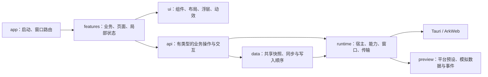

# React 前端重构：架构与验收

- 每个 WebView 组装一个环境和 WindowKind。原生使用实际宿主及现有能力握手，桥故障不得回退到 mock；预览统一解析 mac/win/android/harmony，平台、能力、键位、尺寸和设置共享一个来源。保留懒加载、语言就绪、早期主题和字体、静默启动。Android 以单一面板状态机管理 QA/语音编辑/返回键，取消旧会话成功后切换，新代次拒绝旧回包。沿用已有 IPC、DTO、权限和偏好持久化键；使用现有 PreferencesWriteGate 和云恢复流程。
- 页面走分域 API；跨页快照和读写顺序归 data，选中、草稿、滚动归页面或业务控制器。每个窗口的交互控制器提供 confirm/warn/notify/openDialog；按请求 ID 收尾，现有 supersede 语义，Escape、替换、页面或窗口销毁结算为取消，只有顶层捕获键盘/外点并恢复可用焦点。UI 返回选择，业务层实际提交，成功必须在成功回包后。临时通知与持续警告保留不同语义。系统文件选择、权限及分享走适配器。沿用 Base UI 的 select/combobox/tooltip 及 Rare UI 热力图组件。
- 历史数据服务先订阅再读快照；Tauri 按 history_changed revision 去重但不忽略不同 revision，Harmony 复用变更信号，调用完成、手动/前台刷新走同一个失效入口。记录、活动、按年应用统计各为查询键，每键最多一条在途读取；失效发生在读取期间需补读，过期结果不得提交。历史和随手记保留动作语义，清空不改累计活动和服务账本。模拟适配先提交数据再发事件，读取返回独立快照；包含普通记录、随手记和活动数据，覆盖活跃录音拒绝。后台事件不发成功通知。
- 每窗一个未缩放的 AppViewport，内容和 Portal 共用可见边界；内容及浮层面板按同一比例各缩放一次，位置和命中用未缩放视口坐标。用 Base UI 的 container/collisionBoundary；明确滚动所有者，概览的窄小场景在看板内部重排和滚动，保留 11px 格子、3px 间距及署名。连续圆角只作用于装饰或明确变体，焦点与文案不裁切。对照尺寸由实际内容区定义，同 SHA、数据、语言、主题、字号、显示器工作区及操作顺序，测试 90/100/110%、暗/亮、长文本、开闭中、极小窗口和触屏。
- 原生先用现有 QA 展开、胶囊语言菜单、失败卡高度能力，命令成功后通过首次测量/resize/ResizeObserver 验证当代可绘制和命中区域，再入场；退出先停交互再释放空间。保留工作区、Windows 独立轨、穿透、非激活窗焦点和退出重建语义。越界内容内部滚动或翻转，不能靠隐藏内容、破坏预览或固定延时掩盖。无现有宿主能力的事项单列。

| 旧路径（app/src 内） | 目标与职责 |
|---|---|
| main、App、CoreStartupScreen、FloatingShell、WindowChrome、MobileMoreSheet/MobileStyleSheet、useAppState | app/bootstrap/windowRoutes/startup；app/shell/navigation：启动、导航、窗口、Android 面板 |
| SettingsModal、pages/settings/tabs/navigation/shared/各节 | features/settings/shell/sections；导航、搜索、焦点；按外观、输入、权限、服务、模型、数据、更新拆节 |
| ChannelList、ProvidersSection、ProviderForm、CloudSyncSection、RecordingInputSection、ShortcutsSection、RemoteInputSection | features/providers、cloud-sync、input、remote-input；渠道目录、凭据草稿/写队列、恢复/协议、设备与网络控制器 |
| Overview、History、QuickNote、Usage | features/overview、history、quick-note、usage + data/history/usage；概览各指标、列表/详情/菜单/播放器/重转写润色、独立账本 |
| Style、Marketplace、Vocab、Corrections、Translation、SelectionAsk | features/style-packs、marketplace、vocabulary、corrections、translation、selection-guide；查询、编辑草稿、提交、导入导出及反馈拆分 |
| pages/LocalAsr、lib/localAsr* | features/local-asr；目录、下载准备、激活回收、试跑和详情；下载通知消费共享状态 |
| QaPanel、VoiceEditPanel、SelectionVoiceIntentPicker、QaSurface、QaAnswerFooter、DeepSeekReadAloud、chat | features/qa、voice-edit、selection-intent；会话和取消、几何、编辑器、消息和朗读；迁移 Tailwind @source |
| Capsule、CapsuleTranslationBadge、LiveTranscriptPill、OpenLessCapsule、InsertFallbackCard、LearnVocabulary、VocabSuggestionCard、AudioCue、SiriGL | features/capsule、vocabulary-learning；runtime/windows；ui/motion；会话、视图和几何分离 |
| DesktopOnboarding、Onboarding、HarmonyDictation、AutoUpdate*、GlobalDownloadProgress、CloudSyncSetupPrompt、GithubLoginModal | features/onboarding、dictation、updates、downloads、cloud-sync、accounts；保留跨域状态所有者 |
| pages/_atoms、pages/settings/shared、components/ui、Tooltip、ConfirmDialogHost、NotificationCenter、SavedToast | ui/controls/layout/overlays/feedback/motion；基础组件用参数/回调，不直连业务 |
| styles、lib/fontScale/typography/themeMode/motion/useExitMount 等 | ui/styles 和 ui/motion；领域 CSS 随功能，迁移确认可替代的覆盖 |
| lib/ipc、platform、harmonyBridge、backendEvent、types、state/HotkeySettingsContext、android/frontend | api/contracts/domains、runtime/tauri/harmony/windows、data/preferences；保留 @android 约束和 i18n/生成数据归属 |
| lib/mockData、ipc/mock-data*、散落预览参数、e2e support/fixtures | preview/profiles/fixtures/store/adapter；测试专用文件留 e2e |

清理已证实无效的保守/可读布局空实现、SectionDesc、旧聊天波形和头像生产链。清理前审计脚本、测试、样式、路径和原生路由，不删除实际 SelectionAsk、生成资产或兼容字段。防止用移动 JSX 替代职责拆分。

验收覆盖 Chromium、已安装的 macOS WKWebView、Windows WebView2、Android WebView、Harmony ArkWeb 受影响场景，待验证明确列明。保留焦点与可操作性。原生窗口确认不可取得、Harmony 音频清理、后台桥缺失和独立服务账本写入信号分别跟踪，不改后端或容器来规避。
